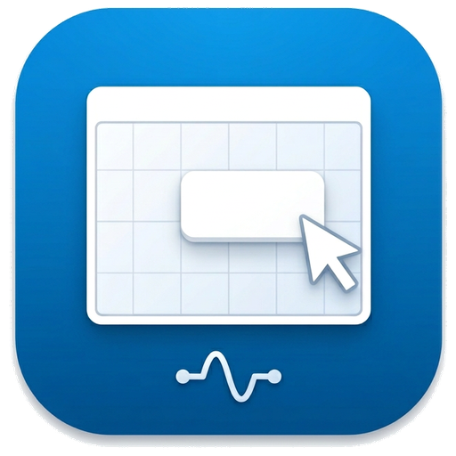
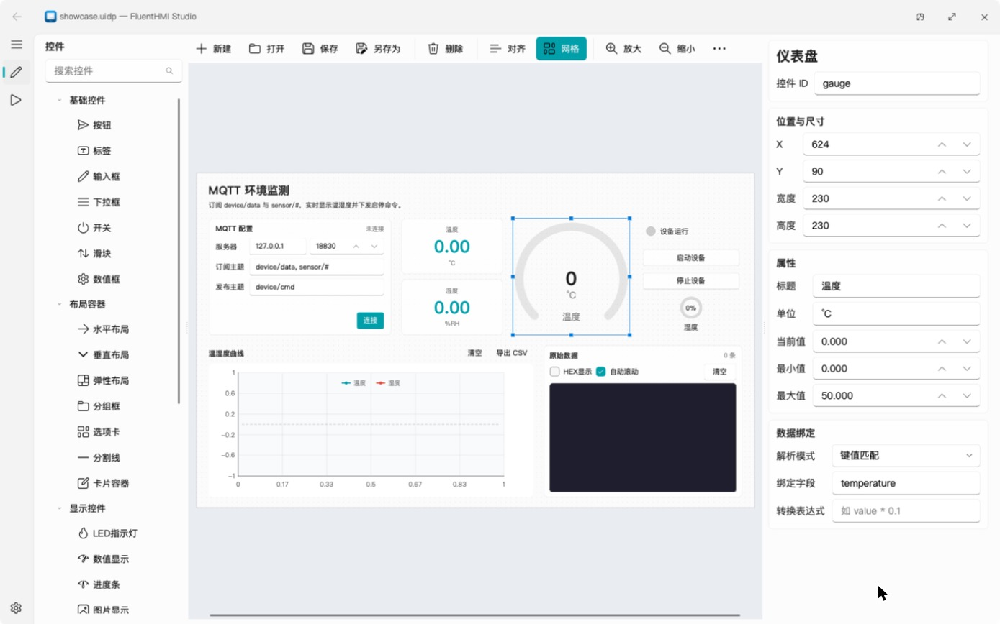
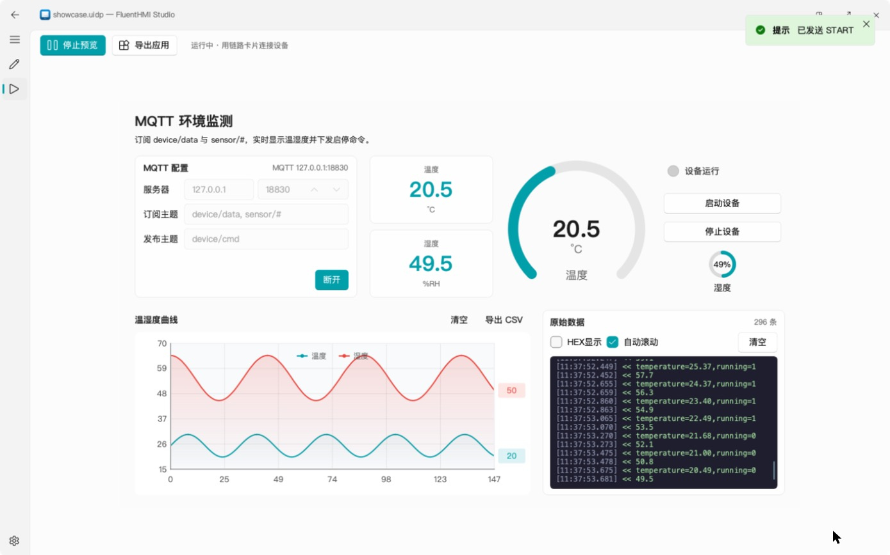
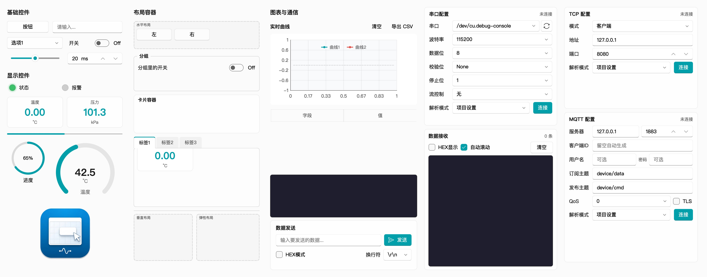
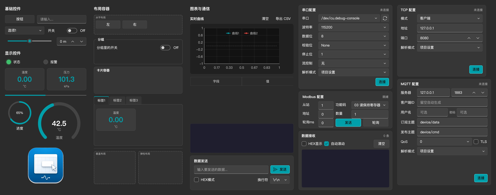

<p align="center">
  
  <h1 align="center">FluentHMI Studio</h1>
  <p align="center">面向硬件工程师的 C++ 可视化上位机设计器 · 基于 <a href="https://github.com/txp666/FluentQtWidgets">FluentQtWidgets</a></p>
</p>

FluentHMI Studio 是 [PyQt UI Designer](https://github.com/txp666/PyQt-UI-Designer) 的 C++/Qt 6 重写版：拖拽控件、配置属性、绑定串口、TCP 或 MQTT 数据，然后把设计导出成一个**不需要编译器**就能运行的独立应用。和 Python 版相比，安装包更小，启动约快一倍，导出不到一秒，还能在应用内更新（见[与 Python 版相比](#与-python-版相比)）。

## 界面预览

### 界面设计

拖拽控件到画布，在右侧编辑属性和数据绑定：



### 预览运行

同一份工程连上设备即可实时运行，导出的应用也用同一个运行时（图中为 MQTT 模拟设备的数据）：



### 全部控件

29 种控件在浅色和深色主题下的样子：





## 让 AI 写工程

`.uidp` 是 JSON 文件。把需求和下面这个链接一起交给 Claude、Codex 等 AI，它就能直接写出工程文件：

```text
https://raw.githubusercontent.com/txp666/FluentHMI-Studio/main/docs/uidp-format.md
```

这是 [docs/uidp-format.md](docs/uidp-format.md) 的原始文本，AI 一次就能读完，不用打开网页或克隆仓库。说明里有规则、一个完整的例子和控件一览；每个控件的全部属性在 [docs/uidp-widgets.md](docs/uidp-widgets.md)，由程序生成，说明里有它的链接，用到时再读。写完用 `FluentHMIRuntime 工程.uidp --check` 检查，再用 Studio 打开、预览和导出。

## 与 Python 版相比

两者使用同一种工程格式，控件和协议规则一致：

- **工程格式兼容**：直接读写 `.uidp`（版本 1.0），控件类型、属性名、默认值和枚举选项与 PyQt UI Designer 一一对应。`examples/` 里的 9 个示例工程都能打开、预览，并按原样保存。
- **解析与绑定规则一致**：行文本（键值 / JSON / CSV）、HEX 帧、Modbus RTU、Modbus TCP 四种解析器，键值匹配 / JSON 路径 / HEX 字节提取 / Modbus 四种绑定，以及文本 / HEX / Modbus 三种命令编码，均按 Python 版逐条移植并有单元测试覆盖。

不同之处在实现和导出方式：

| | FluentHMI Studio 0.1.0 | PyQt UI Designer 0.1.6 |
| --- | --- | --- |
| 实现 | C++17 / Qt 6，原生编译 | Python / PyQt5（Qt 5），用 Nuitka 打包 |
| 导出应用 | 复制预编译的运行器，再放入工程和图片，约 0.3 秒，不需要 Python 和编译器 | 生成 Python 源码，再用 Nuitka 编译；下载的设计器要打包时需另装 Python 与编译工具 |
| 预览与导出 | 预览和导出的应用是同一个运行器，预览看到的就是导出后的效果 | 预览在设计器内运行，导出的是另外生成的代码 |
| macOS 安装包 | 一个 universal 包，32.7 MB（解压后 76 MB），Apple Silicon 与 Intel 通用；导出的应用同样是 universal | arm64、x64 各一个包，53.8 / 62.8 MB（arm64 版解压后 155 MB）；打包只生成本机架构的程序 |
| Windows 安装包 | 16.7 MB | 54.2 MB |
| 启动到出现窗口 | 0.7–1.1 秒 | 1.5–2.2 秒 |
| 启动后内存 | 71–85 MB | 126–137 MB |
| 更新 | 应用内检查、下载、校验并替换，可设为启动时检查 | 设置页手动检查，有新版本时打开下载页 |

安装包大小取自两者的 GitHub Release。启动和内存在同一台 Mac（Apple M5 Pro，48 GB，macOS 27.0.1）上用两个版本的 Apple Silicon 程序测得：空工程，各启动 4 次，取后 3 次（第一次分别为 2.0 秒和 3.9 秒）；内存为窗口出现 5 秒后的常驻内存。导出时间是导出 `examples/demo.uidp` 三次的耗时（0.26–0.41 秒）。

Python 版目前仍有、这里还没有的：导出可以继续修改的源码工程，实时曲线的游标和数据保存 / 加载（见下方路线图）。

## 架构

```
src/core      fhmi_core     工程模型、控件元数据、协议解析、数据绑定、命令编码（只依赖 Qt Core）
src/comm      fhmi_comm     Link 接口 + 串口 / TCP 客户端 / TCP 服务端 / MQTT，CommHub 汇总所有链路
src/runtime   fhmi_runtime  基于 FluentQtWidgets 的运行时控件、RuntimeSurface、绑定引擎
src/designer  fhmi_designer 画布（QGraphicsScene）、控件面板、属性编辑器、对齐与容器嵌套
src/studio    FluentHMIStudio   设计器应用：界面设计 / 预览运行 / 设置，导出服务
src/player    FluentHMIRuntime  导出应用的运行器：读取自身旁边（或 .app 内）的 project.uidp
tools         uidp_reference    从控件注册表重新生成 docs/uidp-widgets.md 和 docs/uidp-format.md 末尾的控件一览
```

设计画布上显示的就是真实的运行时控件，套在 QGraphicsProxyWidget 里且不响应鼠标。预览和导出应用把同一批控件挂到 RuntimeContext 上，由它接收链路数据、执行绑定、发送命令。

## 构建

需要 CMake 3.21+、C++17、Qt 6.5+（Core、Gui、Widgets、Svg、Network、SerialPort）。

```bash
git clone --recursive https://github.com/txp666/FluentHMI-Studio.git
cd FluentHMI-Studio
cmake --preset debug
cmake --build --preset debug
ctest --preset debug
```

macOS 运行 `open build/debug/FluentHMIStudio.app`。无界面导出：

```bash
FluentHMIStudio --export <输出目录> <工程.uidp>
```

运行器可以把整个工程画面渲染成图片，`docs/images` 里的控件一览就是这样生成的：

```bash
FluentHMIRuntime <工程.uidp> --theme dark --screenshot widgets-dark.png
```

## 在线更新

Studio 从本仓库的 GitHub Release 获取更新。设置页有"检查更新"按钮和"启动时检查更新"开关（默认开启；启动检查只在发现新版本时弹窗，网络错误不打扰）。发现新版本时显示更新说明，可以立即更新、跳过此版本或以后再说。

立即更新会下载本平台的安装包（`-macos-universal.zip` / `-windows-x64.zip`），用 Release 里的 `.sha256` 校验大小和 SHA-256，解压到安装目录旁边的 `.fluenthmi-update` 文件夹。之后点"重启并更新"，或者稍后退出 Studio 时，一个小的辅助脚本（macOS 用 sh，Windows 用 PowerShell）会等 Studio 退出、把旧版本移开、换上新版本、按需重新启动，最后删掉旧版本；换不上时恢复旧版本，下次启动会提示原因。从构建目录运行、macOS 从隔离的临时位置运行、或者没有写入安装目录的权限（例如装在 Program Files）时，不会自动更新，改为打开下载页。

无界面更新，安装包会在这个进程退出后被替换：

```bash
FluentHMIStudio --update
```

测试更新流程时，可以用 `FHMI_UPDATE_URL` 指向本地服务器上与 GitHub "latest release" 接口格式相同的 JSON。仓库公开之前，GitHub 对匿名请求返回 404，检查更新会提示"没有找到已发布的版本"。

## 打包与发布

```bash
cmake --preset release && cmake --build --preset release
python3 scripts/package.py --build-dir build/release --output-dir dist
```

macOS 生成 `FluentHMI Studio.app`，运行器位于 `Contents/Helpers/FluentHMIRuntime.app`；Windows 生成 `FluentHMI-Studio/`，Studio 和运行器两个 exe 在同一目录。包里只有一份 Qt：macOS 上 Qt 放在运行器里，Studio 通过 rpath 和 `qt.conf` 使用它；Windows 上两者共用目录里的 Qt DLL 和插件，`runtime-files.txt` 记录运行器需要的文件。导出应用时只复制运行器及其 Qt，导出的应用因此可以直接拷到别的电脑上运行。脚本最后会用打包好的 Studio 导出 `examples/demo.uidp`，再以 `--check` 启动导出的应用，任何一步失败都不会产出压缩包。在 macOS 上它还会检查没有任何库仍从构建机的 Qt 目录加载，并用 `DYLD_PRINT_LIBRARIES` 确认 Studio 和导出的应用运行时只加载系统库和包内的库。产物为 zip 加 `.sha256`；macOS 只做了 ad hoc 签名，没有 Developer ID 签名和公证。

发布新版本：修改 `CMakeLists.txt` 中 `project(... VERSION ...)`，可选地添加 `docs/release-notes/vX.Y.Z.md`，然后推送 `vX.Y.Z` 标签。`Release` 工作流会在 Windows 和 macOS（universal）上构建、测试、打包，全部通过后才发布 GitHub Release。

## 当前状态（0.1.0）

已完成：全部 29 种控件、拖拽设计、网格吸附、缩放、对齐与分布、容器嵌套（水平 / 垂直 / 弹性 / 卡片 / 选项卡）、属性与数据绑定编辑、保存 / 打开 / 另存为（相对图片路径随工程目录迁移）、串口 / TCP / MQTT 预览、导出独立应用、Windows 与 macOS 打包、浅色 / 深色主题、全部 Fluent 风格滚动条、在线更新（检查、下载校验、替换并重启）。

MQTT 链路是自带的 MQTT 3.1.1 客户端（基于 QSslSocket，无需 Qt MQTT 模块）：支持用户名密码、QoS 0/1/2、`+`/`#` 通配符订阅，TLS 使用系统证书库；连接成功后若断开会自动重连。与 Python 版一致，每条消息视为一帧，纯数值载荷还会以主题名为键再给出一份。

已在 macOS 上做过端到端验证：TCP 和 MQTT 模拟设备的数据显示、曲线和命令下发，导出应用的运行，以及在本机打包后解压运行。Windows 包在发布工作流（Windows Server 2022）中做导出自检，并在 Windows 11 ARM64 虚拟机上（x64 仿真）验证过解压运行、导出和导出应用的运行。尚未验证的：连接真实 MQTT broker 和 TLS。

路线图：

- 撤销 / 重做、复制 / 粘贴
- 实时曲线的完整历史记录、游标、CSV/JSON 加载
- 导出应用使用工程自己的图标
- 导出 C++/CMake 源码工程，供需要二次开发的用户使用
- Developer ID 签名与公证、Windows 代码签名
- UDP、蓝牙；英文界面

## 许可

GPL-3.0，与 FluentQtWidgets 和 PyQt UI Designer 保持一致。
