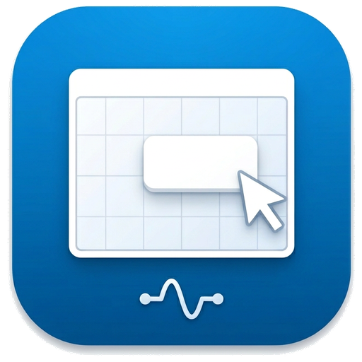
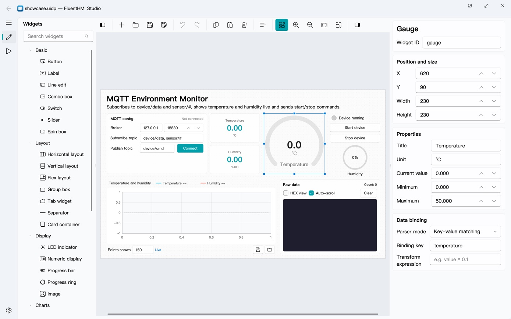
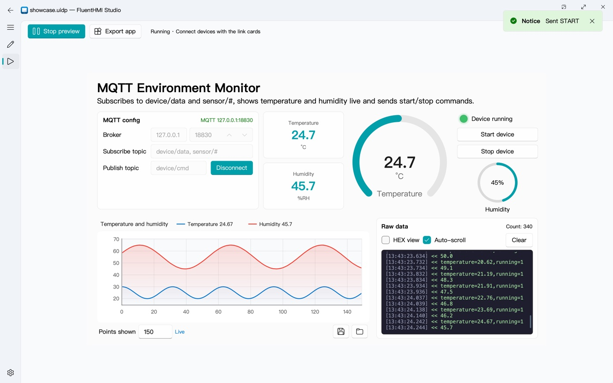
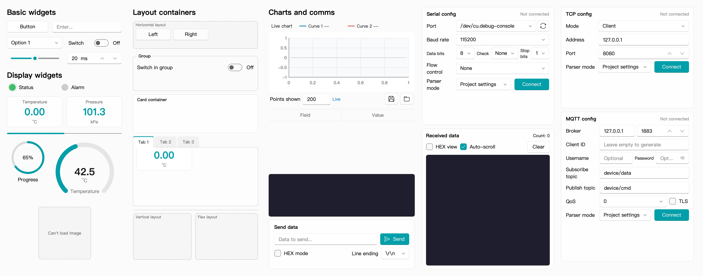
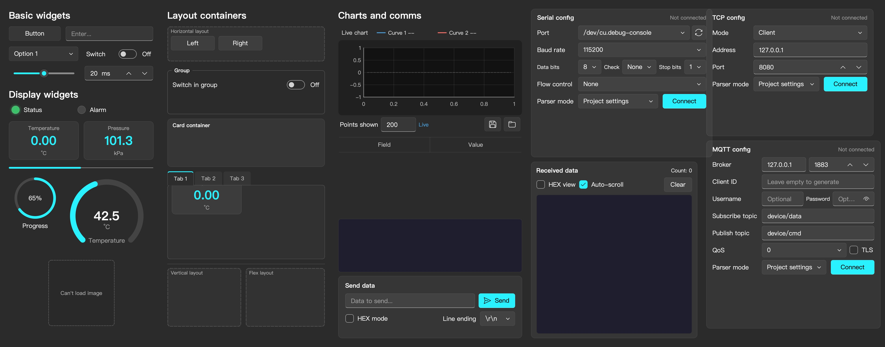

<p align="center">
  
  <h1 align="center">FluentHMI Studio</h1>
  <p align="center">A C++ visual HMI designer for hardware engineers · built on <a href="https://github.com/txp666/FluentQtWidgets">FluentQtWidgets</a></p>
  <p align="center">English · <a href="README_zh.md">简体中文</a> · <a href="https://hmi.modusignal.cn/">Website</a> · <a href="https://hmi.modusignal.cn/guide/">User guide</a></p>
</p>

FluentHMI Studio is a C++/Qt 6 rewrite of [PyQt UI Designer](https://github.com/txp666/PyQt-UI-Designer): drag widgets onto a canvas, set their properties, bind them to serial, TCP, MQTT, UDP or CAN data, then export the design as a standalone app, with **no compiler needed**. Compared with the Python version, the download is smaller, it starts about twice as fast, exports take under a second, and it can update itself from inside the app (see [Compared with the Python version](#compared-with-the-python-version)).

> **Language**: the interface is in English or Simplified Chinese (Settings → Language).

## Screenshots

### Designing

Drag widgets onto the canvas, and edit their properties and data bindings on the right:

<picture><source media="(prefers-color-scheme: dark)" srcset="docs/images/designer-en-dark.jpg"></picture>

### Live preview

The same project runs live once it is connected to a device, and exported apps use the same runtime (the data in the screenshot comes from a simulated MQTT device):

<picture><source media="(prefers-color-scheme: dark)" srcset="docs/images/preview-en-dark.jpg"></picture>

### All widgets

The 28 widgets in the light and dark themes:





## Let AI write the project

A `.uidp` file is JSON. Give Claude, Codex or another AI your requirements together with this link, and it can write the project file directly:

```text
https://raw.githubusercontent.com/txp666/FluentHMI-Studio/main/docs/uidp-format.md
```

This is the raw text of [docs/uidp-format.md](docs/uidp-format.md), which an AI can read in one go without opening a web page or cloning the repository. The guide is written in Chinese, and AI assistants can read it as it is. It has the rules, a complete example and a list of widgets; every property of every widget is in [docs/uidp-widgets.md](docs/uidp-widgets.md), which is generated by the program and linked from the guide for when it's needed. When the file is written, check it with `FluentHMIRuntime project.uidp --check`, then open, preview and export it in Studio.

## Open projects in the browser

[The Custom device page on modusignal.cn](https://modusignal.cn/#custom) opens, edits and runs the same `.uidp` with nothing to install: serial cards use the browser's serial support (Chrome, Edge), MQTT cards connect to the broker's WebSocket address and TCP cards connect over WebSocket. CAN, UDP, the image widget and the Modbus slave role work only in Studio, and apps are exported from Studio.

## Compared with the Python version

Both use the same project format, and their widget and protocol rules match:

- **Compatible project format**: it reads and writes `.uidp` (version 1.0) directly, and its widget types, property names, default values and enum options match PyQt UI Designer one to one. All 11 example projects in `examples/` open, preview, and save back unchanged.
- **Same parsing and binding rules**: the five parsers (line text with key-value / JSON / CSV; binary HEX frames with header and footer, length field, checksum, fixed length or idle-gap framing; Modbus RTU; Modbus TCP; Modbus ASCII), the four kinds of binding (key-value matching / JSON path / HEX byte extraction / Modbus) and the four command encodings (text / HEX / JSON / Modbus) were ported from the Python version rule by rule and are covered by unit tests.
- **Same Modbus features for PLCs**: read requests sent from here are remembered, so the registers in a reply are also named by address (holding register 100 is `hr100`) and a binding picks a register table and an address; pick a Modbus parser on the link card and bind a register address, and it is read automatically: nearby addresses are merged into blocks read at their periods, one request at a time, only for the controls on screen, with writes sent ahead of queued reads; FC16 writes int16, 32-bit integers and float32 values by data type.
- **Modbus RTU / TCP slave**: a serial, TCP or UDP card can act as a slave and answer an external master from its own data table; bindings, controls and write commands read and write that table, and the slave register table widget shows and edits it.
- **CAN / CAN FD (Studio only)**: a CAN card connects to a PEAK, ZLG, SocketCAN or slcan adapter and decodes frames with a DBC file or signals written on the card, so the usual bindings, charts and tables show them; controls send DBC signals or raw frames, once or cyclically, and a monitor lists every ID with its period (see [CAN adapters](#can-adapters)). Projects that use it open in Studio only.

The differences are in how they are built and how they export apps:

| | FluentHMI Studio 0.5.0 | PyQt UI Designer 0.4.0 |
| --- | --- | --- |
| Implementation | C++17 / Qt 6, compiled natively | Python / PyQt5 (Qt 5), packaged with Nuitka |
| Exporting an app | Copies a prebuilt runner and adds the project and images, about 0.3 s, no Python or compiler needed | Generates Python source, then compiles it with Nuitka; the downloaded designer needs Python and build tools installed separately to package |
| Preview and export | The preview and the exported app are the same runner, so the preview shows exactly what the export will look like | The preview runs inside the designer; the export is separately generated code |
| macOS package | One universal package, 32.7 MB (79 MB unpacked), for both Apple Silicon and Intel; exported apps are universal too | One package each for arm64 and x64, 51.7 / 60.3 MB (156 MB unpacked for arm64); packaging only builds for the local architecture |
| Windows package | 17.7 MB | 52.0 MB |
| Time to first window | 0.7–1.1 s | 1.5–2.2 s |
| Memory after startup | 71–85 MB | 126–137 MB |
| Updates | Checks, downloads, verifies and replaces itself in the app; can check at startup | Manual check on the settings page, which opens the download page when there is a new version |

Package sizes are taken from each project's GitHub Release. Startup and memory were measured on the same Mac (Apple M5 Pro, 48 GB, macOS 27.0.1) with the Apple Silicon builds of both versions: an empty project, launched 4 times each, counting the last 3 (the first launch took 2.0 s and 3.9 s respectively); memory is the resident memory 5 seconds after the window appears. The export time is from exporting `examples/demo.uidp` three times (0.26–0.41 s).

What the Python version still has and this one doesn't yet: exporting a source project you can keep editing (see the roadmap below).

## Linux

### Install

Each release has a .deb for x64 and for arm64: `FluentHMI-Studio-vX.Y.Z-linux-x64.deb` (26.7 MB, 91 MB installed) and `FluentHMI-Studio-vX.Y.Z-linux-arm64.deb` (26.4 MB, 92 MB installed). They install on Ubuntu 24.04 or later, Debian 13 and Raspberry Pi OS trixie, which have glibc 2.39 or later; Raspberry Pi OS bookworm and most RK3568 vendor images (Debian 11/12, Ubuntu 20.04/22.04) are too old.

```bash
sudo apt install ./FluentHMI-Studio-vX.Y.Z-linux-x64.deb
```

apt installs the system libraries Studio needs. Studio goes to `/opt/FluentHMIStudio`; start it from the application menu or with `fluenthmi-studio`. The launcher runs it on X11 (XWayland on a Wayland desktop) unless `QT_QPA_PLATFORM` is set, since that is where its frameless title bar is proven.

### Exported apps

On Linux an export is one file, `<App>.tar.gz`, which keeps the program executable wherever it is copied to. It holds the folder `<App>/`: the program `<App>`, `start.sh`, `lib/` and `plugins/` with Qt and the X11 helper libraries minimal systems lack, `qt.conf`, `project.uidp`, `appearance.json`, `assets/`, and `<App>.png`, the project's icon (or the FluentHMI logo) at 256 px.

```bash
tar -xzf <App>.tar.gz
./<App>/start.sh
```

`start.sh` runs the app from its own folder, on X11 when there is a display and `QT_QPA_PLATFORM` is not set. To use the app on another machine of the same architecture, copy the archive there (`scp`, a USB stick) and unpack it. That machine needs glibc 2.39 or later and these system libraries, which desktop installs have:

```bash
sudo apt install libgl1 libopengl0 libegl1 libfontconfig1 libfreetype6 libglib2.0-0t64 libdbus-1-3 \
  libudev1 libssl3t64 libgssapi-krb5-2 libxkbcommon0 libx11-6 libx11-xcb1 libxext6 libxfixes3 libxi6 \
  libxrender1 libsm6 libice6 libxcb1 libxcb-glx0 libxcb-randr0 libxcb-render0 libxcb-shape0 \
  libxcb-shm0 libxcb-sync1 libxcb-xfixes0 libxcb-xinerama0 libxcb-xinput0 libxcb-xkb1 \
  libwayland-client0 libwayland-cursor0 libwayland-egl1
```

Chinese text needs a CJK font; on a board image without one, install `fonts-noto-cjk`.

To put the app in the application menu, save a desktop entry as `~/.local/share/applications/<App>.desktop`, named after the program, which is the name the app gives the desktop. A copy in `~/.config/autostart/` starts it at login:

```ini
[Desktop Entry]
Type=Application
Name=<App>
Exec="/home/pi/<App>/start.sh"
Icon=/home/pi/<App>/<App>.png
StartupWMClass=<App>
Terminal=false
```

To start it at boot full screen, with no desktop, a systemd service can run it on eglfs, which draws through the GPU's DRM/KMS driver (it uses the system's `libdrm2`, `libgbm1` and, for touch and keys, `libinput10`); where there is no GPU driver, `QT_QPA_PLATFORM=linuxfb` draws on the framebuffer instead. Save it as `/etc/systemd/system/<App>.service`, then `sudo systemctl enable --now <App>`:

```ini
[Unit]
Description=<App>

[Service]
User=pi
SupplementaryGroups=dialout video render input
Environment=QT_QPA_PLATFORM=eglfs
ExecStart=/home/pi/<App>/start.sh
Restart=on-failure

[Install]
WantedBy=multi-user.target
```

Studio exports apps for the system it runs on, so a Linux app comes from Studio on Linux of the same architecture, which can be the board itself. Export from the command line there, with `QT_QPA_PLATFORM=offscreen` in front when there is no display (over SSH):

```bash
fluenthmi-studio --export out project.uidp
```

### Serial ports

A serial port's device node (`/dev/ttyUSB0`, `/dev/ttyACM0`, ...) belongs to a group, `dialout` on Debian, Ubuntu and Fedora and `uucp` on Arch, and only its members may open it. When Studio or an exported app has no permission to open a port, it names the group; add yourself to it, then log out and back in:

```bash
sudo usermod -aG dialout $USER
```

- On Ubuntu 22.04, `brltty` (a braille display service) grabs CH340/CH341 USB serial adapters. If `/dev/ttyUSB0` appears and vanishes again, remove it: `sudo apt remove brltty`.
- ModemManager probes a newly plugged `ttyACM` device for a few seconds; the port is busy until it has finished.

## CAN adapters

Nothing is bundled; what each adapter needs:

| Adapter | Windows | macOS | Linux |
| --- | --- | --- | --- |
| PEAK (PCAN-USB, PCAN-USB FD) | PEAK's device driver, which installs `PCANBasic.dll` | the PCBUSB library from [mac-can.com](https://mac-can.github.io/drivers/libPCBUSB.html) (`libPCBUSB.dylib` in `/usr/local/lib`) | choose SocketCAN: the kernel's `peak_usb` driver |
| ZLG (USBCAN-I/II, USBCAN-E-U family, USBCANFD) | ZLG's device driver, and from ZLG's 64-bit "CAN interface function library" `zlgcan.dll` with its `kerneldlls` folder, next to the program or in a `zlgcan` folder beside it | – | – |
| SocketCAN | – | – | built in; the interface's bitrate is set with `ip link` (the card shows the command, e.g. `sudo ip link set can0 up type can bitrate 500000 sample-point 0.875`) |
| slcan (CANable, CANUSB and other Lawicel-protocol adapters) | the adapter's serial port | the adapter's serial port | the adapter's serial port; classic CAN only, 10k–1M |

How the card, DBC keys, inline signals and CAN commands are written in a `.uidp` is in [docs/uidp-format.md](docs/uidp-format.md#接-can-总线).

## Architecture

```
src/core      fhmi_core     Project model, widget metadata, protocol parsing, data binding, command encoding, CAN signals / DBC / bit timing (Qt Core only)
src/comm      fhmi_comm     Link interface + serial / TCP client / TCP server / MQTT / UDP / CAN (src/comm/can: PCAN, ZLG, SocketCAN, slcan); CommHub gathers all links
src/runtime   fhmi_runtime  Runtime widgets built on FluentQtWidgets, RuntimeSurface, binding engine
src/designer  fhmi_designer Canvas (QGraphicsScene), widget panel, property editor, alignment and container nesting
src/studio    FluentHMIStudio   The designer app: design / preview / settings pages, export service
src/player    FluentHMIRuntime  The runner for exported apps: reads the project.uidp and appearance.json next to it (or inside the .app)
tools         uidp_reference    Regenerates docs/uidp-widgets.md and the widget list at the end of docs/uidp-format.md from the widget registry
```

The design canvas shows the real runtime widgets, wrapped in QGraphicsProxyWidget and ignoring the mouse. The preview and exported apps attach the same widgets to a RuntimeContext, which receives data from the links, applies the bindings and sends commands.

## Building

Requires CMake 3.21+, C++17 and Qt 6.12 (Core, Gui, Widgets, Svg, Network, SerialPort). A Qt in the default folder of the Qt installer or aqtinstall (`~/Qt`, `C:\Qt`) is found by itself; for one anywhere else, add `-DCMAKE_PREFIX_PATH=<qt-dir>`. On Linux, also install `libgl1-mesa-dev`, `libxcb-cursor0` and `libxkbcommon-x11-0`.

```bash
git clone --recursive https://github.com/txp666/FluentHMI-Studio.git
cd FluentHMI-Studio
cmake --preset debug
cmake --build --preset debug
ctest --preset debug
```

In VS Code, open this folder: Ctrl/Cmd+Shift+B builds, and F5 builds and starts Studio. On Windows, start VS Code from a Developer PowerShell for Visual Studio, so that CMake finds the compiler, and before the first F5 pick "Debug FluentHMI Studio (Windows, MSVC)" under Run and Debug.

On macOS, run `open build/debug/FluentHMIStudio.app`; on Linux, `build/debug/FluentHMIStudio`. To export without the UI:

```bash
FluentHMIStudio --export <output-dir> <project.uidp>
```

An exported app starts with the theme (light, dark or follow system), theme colour and language set on Studio's Settings page at export time, as the preview shows them; all three go into `appearance.json` beside the project inside the app, and a headless export uses Studio's saved settings. When the runner opens a project directly, it keeps its own saved settings.

The Language setting on the Settings page offers Follow system, 简体中文 and English, and takes effect when Studio restarts. Following the system shows Simplified Chinese on a Chinese system and English anywhere else; an exported app set to follow the system follows the system of the computer it runs on.

The runner can render a whole project to an image; the widget overviews in `docs/images` were made this way:

```bash
FluentHMIRuntime <project.uidp> --theme dark --screenshot widgets-dark.png
```

## Online updates

Studio gets updates from this repository's GitHub Releases. The settings page has a Check for updates button and a Check for updates at startup switch, which is on by default; the startup check only shows a dialog when it finds a new version, and stays quiet on network errors. When a new version is found, it shows the release notes, and you can update now, skip this version or decide later.

Updating now downloads the package for your platform (`-macos-universal.zip` / `-windows-x64.zip`), checks its size and SHA-256 against the `.sha256` file in the Release, and unpacks it into a `.fluenthmi-update` folder next to the install folder. Then click Restart and update (重启并更新), or quit Studio later, and a small helper script (sh on macOS, PowerShell on Windows) waits for Studio to exit, moves the old version aside, puts the new one in its place, restarts it if asked to, and finally deletes the old version. If the new version can't be put in place, the script restores the old one, and the next launch tells you why. When Studio runs from a build folder, from a quarantined temporary location on macOS, or without permission to write to its install folder (for example under Program Files), it doesn't update itself and opens the download page instead.

On Linux the package is the .deb (`-linux-x64.deb` / `-linux-arm64.deb`), verified the same way and kept as it is in `~/.cache/FluentHMI/FluentHMI Studio/update`. When Studio exits, pkexec asks for an administrator's password. As root, the installation then copies the package to a folder of its own, checks the copy's SHA-256 again, checks that it is FluentHMI Studio for this system's architecture, waits for Studio to exit, and installs it with `apt-get`. Studio restarts as you, never as root, if asked to; a failed installation leaves the old version in place, and the next launch tells you why. This needs Studio installed from the .deb in `/opt/FluentHMIStudio`, and pkexec and apt-get on the system; otherwise Studio opens the download page.

To update without the UI (the package is replaced after this process exits):

```bash
FluentHMIStudio --update
```

To test the update flow, point `FHMI_UPDATE_URL` at a JSON file on a local server in the same format as GitHub's "latest release" API.

## Packaging and releases

```bash
cmake --preset release && cmake --build --preset release
python3 scripts/package.py --build-dir build/release --output-dir dist
```

On macOS this produces `FluentHMI Studio.app`, with the runner at `Contents/Helpers/FluentHMIRuntime.app`; on Windows it produces `FluentHMI-Studio/`, with the Studio and runner exes in the same folder; on Linux it produces a .deb that installs the same flat folder as `/opt/FluentHMIStudio`, with Qt's libraries in `lib/` and its plugins in `plugins/`, plus the launcher `/usr/bin/fluenthmi-studio`, a desktop entry and an icon. The package holds a single copy of Qt: on macOS Qt lives in the runner and Studio uses it through its rpath and `qt.conf`; on Windows and Linux both share the Qt libraries and plugins in the folder, and `runtime-files.txt` lists the files the runner needs. On Linux both programs find `lib/` through their RUNPATH (`$ORIGIN/lib`, set with patchelf), and the X11 helper libraries that minimal systems lack are bundled beside Qt's, so an exported app runs where nothing was installed. Exporting an app copies only the runner and its Qt, which is why exported apps can be copied straight to another computer and run. At the end, the script exports `examples/demo.uidp` with the packaged Studio and starts the exported app with `--check`; if any step fails, no archive is produced. On macOS it also checks that no library is still loaded from the build machine's Qt folder, and uses `DYLD_PRINT_LIBRARIES` to confirm that at run time Studio and the exported app load only system libraries and libraries inside the package. On Linux it checks the same with RUNPATHs and `ldd` (no library may be missing), and at run time with `LD_DEBUG=libs`, for Studio unpacked from the finished .deb and for the export unpacked from its tar.gz and started with `start.sh --check`; the programs it starts need a display, so run it under `xvfb-run -a` or in a desktop session. The output is a zip plus a `.sha256` file (on Linux a .deb plus a `.sha256`); macOS builds are only ad hoc signed, without Developer ID signing or notarization.

To release a new version, change `project(... VERSION ...)` in `CMakeLists.txt`, optionally add `docs/release-notes/vX.Y.Z.md`, then push a `vX.Y.Z` tag. The `Release` workflow builds, tests and packages on Windows, macOS (universal) and Linux (x64 and arm64, on Ubuntu 24.04). For each .deb it checks the package name, version, architecture and dependencies, lets apt resolve it, installs it and exports the demo with it, and runs that export in a clean Ubuntu 24.04 container with only the system libraries listed above. It only publishes the GitHub Release when everything passes. Started by hand, or by a pull request that changes the packaging, it packages and checks without publishing.

## Current status (0.5.0)

Done: all 32 widgets, drag-and-drop design, grid snapping, zoom, alignment and distribution, undo / redo, copy / paste (with the same clipboard format as the Python version), container nesting (horizontal / vertical / flex / card / tab), property and data binding editing, save / open / save as (relative image paths follow the project folder when it moves), serial / TCP / MQTT / UDP / CAN preview, standalone app export (with the project's own icon if it has one), the live chart's full history, cursor and CSV/JSON save / load for comparison, Windows, macOS and Linux (x64 and arm64 .deb) packaging, light and dark themes, Fluent-style scroll bars everywhere, online updates (check, download and verify, replace and restart), Modbus bindings named by address and polled automatically, binary frames with a length field and checksum, text parsing with configurable terminator and encoding, and Modbus ASCII.

The MQTT link is a built-in MQTT 3.1.1 client (based on QSslSocket, so the Qt MQTT module isn't needed): it supports username and password, QoS 0/1/2, `+`/`#` wildcard subscriptions, and TLS with the system certificate store, and it reconnects automatically if a connection that succeeded drops. As in the Python version, each message is treated as one frame, and a payload that is a single plain number is also given with the topic name as its key.

Tested end to end on macOS: data display, charts and commands with simulated TCP and MQTT devices, running exported apps, and unpacking and running a package built on the same machine. The Windows package runs an export self-check in the release workflow (Windows Server 2022), and unpacking and running it, exporting, and running the exported app have been checked in a Windows 11 ARM64 virtual machine (under x64 emulation). Not verified yet: connecting to a real MQTT broker, and TLS. CAN has been checked end to end with a simulated slcan adapter only; the PEAK, ZLG and SocketCAN adapters have not been tried on hardware yet.

Roadmap:

- Exporting a C++/CMake source project for people who need to develop it further
- Developer ID signing and notarization, Windows code signing

## License

GPL-3.0, the same as FluentQtWidgets and PyQt UI Designer.
