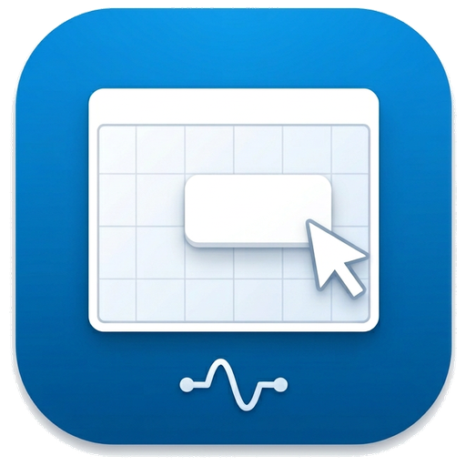
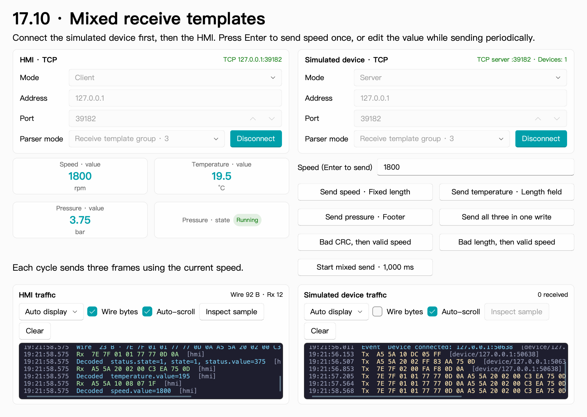
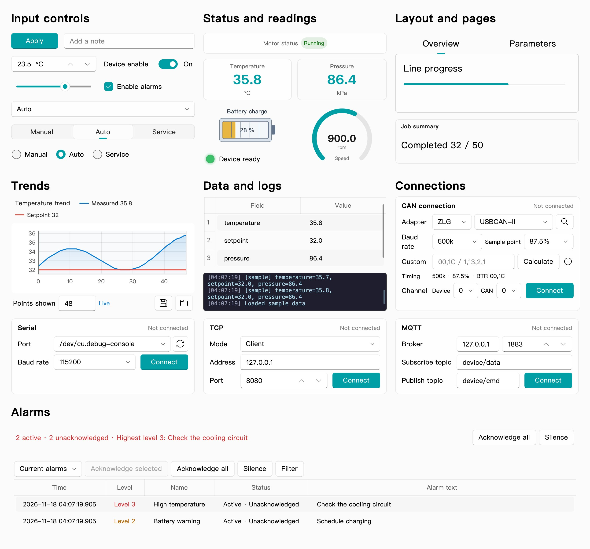
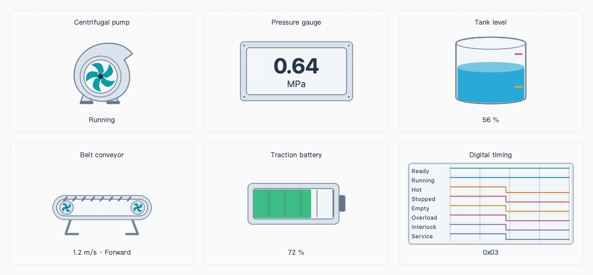

<p align="center">
  
  <h1 align="center">FluentHMI Studio</h1>
  <p align="center">A native Qt visual HMI designer for hardware engineers</p>
  <p align="center"><a href="README_zh.md">简体中文</a> · <a href="docs/guide.en.md">User guide</a> · <a href="https://hmi.modusignal.cn/">Website</a> · <a href="https://github.com/txp666/FluentHMI-Studio/releases">Downloads</a></p>
</p>

Build a device interface by dragging widgets onto a canvas. Connect serial, TCP, UDP, MQTT, CAN / CAN FD, Modbus, or classic S7 devices, bind readings to displays and charts, and configure commands. Preview and exported applications share the runtime. Export includes the project and its assets, so the target machine can run it without a compiler.

**Studio v0.9.0** adds shared frame templates, mixed HEX reception on one connection, field-based commands, and periodic tasks you can manage across pages. The project format is **UIDP 1.3** for these features. [Release notes](docs/release-notes/v0.9.0.md#english) · [Existing project migration](docs/uidp-format.md#从旧版升级)

## Get started

1. Install Studio for Windows x64, macOS universal, or Linux x64/arm64. [Installation](docs/build.en.md#install)
2. Open [17 Data I/O and frame templates](examples/tutorials/17-数据收发与帧模板.uidp). Start Preview, connect the simulated device on the right first, then connect the HMI on the left.
3. Send a target speed and return feedback. Check the received value, chart, and record table. The [walkthrough](docs/tutorials/17-frame-io.en.md#17-share-one-frame-template) gives the exact bytes to expect and explains how to recreate the project.

To try several layouts on one link, open [17.10 Mixed receive templates](examples/tutorials/17.10-同连接多接收模板.uidp). Use the mixed-send button, change the input during periodic sending, and stop it from the task list.



## Learn and configure

| I want to | Start here |
| --- | --- |
| Build a project from scratch and troubleshoot packets | [User guide](docs/guide.en.md) |
| Practice sending, receiving, and frame formats | [Series 17 labs](docs/tutorials/17-frame-io.en.md) · [All example projects](examples/tutorials/README.md) |
| Use CAN with a DBC or a physical adapter | [CAN bit-map tutorial](docs/tutorials/can-bit-map.en.md) · [CAN reference](docs/uidp/can.md) · [Adapter drivers](docs/build.en.md#can-adapters) |
| Read a PLC or write consecutive registers | [Modbus](docs/uidp/connections.md#modbus-主站与从站) · [Classic S7](docs/s7.md) · [S7 tutorial](docs/tutorials/13-s7-plc.en.md) |
| Configure points, alarms, and historical reports | [Project data and alarms](docs/guide.en.md#project-data-and-alarms) |
| Check exact UIDP properties and types | [Project format](docs/uidp-format.md) · [Generated widget reference](docs/uidp-widgets.md) |
| Install, export, update, or package Studio | [Deployment and build guide](docs/build.en.md) · [Architecture](docs/architecture.md) |

## Widget gallery

Inputs, readouts, charting, communication cards, and page containers support light and dark themes. The gallery illustrates their shared style, and the dynamic project shows pump, tank, conveyor, battery, and timing feedback. [Widget gallery project](docs/images/widgets-en.uidp) · [Dynamic widget project](examples/industrial/动态控件全景.uidp)

<picture><source media="(prefers-color-scheme: dark)" srcset="docs/images/widgets-en-dark.jpg"></picture>



## Build a UIDP project with an assistant

A `.uidp` is a UTF-8 JSON file. Give an assistant the project template, the device protocol, and a real message sample. The project reference covers exact property names and enumerations.

```text
https://raw.githubusercontent.com/txp666/FluentHMI-Studio/main/docs/uidp-format.md
```

Check a generated file with `FluentHMIRuntime monitor.uidp --check`, then open it in Studio and verify the route and expected traffic before exporting. [UIDP template](docs/uidp-format.md) · [Using the runtime from the command line](docs/build.en.md#exported-apps)

<a id="compared-with-the-python-version"></a>

## Related tools and project compatibility

FluentHMI Studio is built on [FluentQtWidgets](https://github.com/txp666/FluentQtWidgets). Studio copies a native runner when exporting. [PyQt UI Designer](https://github.com/txp666/PyQt-UI-Designer) can export editable Python source or build with Nuitka. The tools exchange projects for the features they share. V0.9 frame templates and periodic configuration require the matching Studio runtime even though the format remains 1.3.

[modusignal's Custom Device](https://modusignal.cn/#custom) runs supported projects in a browser. It uses Web Serial for serial devices and WebSocket endpoints for network connections. [FluentPLC Simulator](https://github.com/txp666/FluentPLC-Simulator) provides a separate classic S7 server for local testing.

## License

[GPL-3.0](LICENSE). See [Snap7 notices](third_party/SNAP7-NOTICE.md) for the bundled S7 library.
