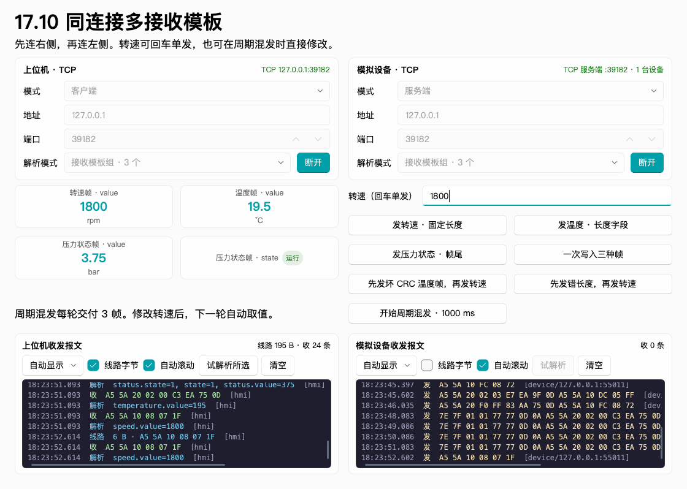

<p align="center">
  
  <h1 align="center">FluentHMI Studio</h1>
  <p align="center">面向硬件工程师的原生 Qt 上位机设计器</p>
  <p align="center"><a href="README.md">English</a> · <a href="docs/guide.zh.md">使用手册</a> · <a href="https://hmi.modusignal.cn/">官网</a> · <a href="https://github.com/txp666/FluentHMI-Studio/releases">下载</a></p>
</p>

拖放控件搭建设备界面，连接串口、TCP、UDP、MQTT、CAN / CAN FD、Modbus 或经典 S7。把设备读数绑定到显示、实时曲线或报警，为按钮和输入控件配置协议下发。预览和独立应用共用运行逻辑，导出会打包运行器及工程资源，可在目标电脑直接运行。

**Studio v0.9.0** 加入工程级收发帧模板、同连接混收多种 HEX 帧、按字段组帧和跨页周期任务管理。新功能采用 **UIDP 1.3**。[更新说明](docs/release-notes/v0.9.0.md) · [旧工程升级](docs/uidp-format.md#从旧版升级)

## 第一次运行

1. 选择 Windows x64、macOS 通用版或 Linux x64/arm64 安装包。[安装与平台要求](docs/build.zh.md#安装)
2. 打开 [17 数据收发与帧模板](examples/tutorials/17-数据收发与帧模板.uidp) 并运行预览，先连接右侧模拟设备，再连接左侧上位机。
3. 发送目标转速并回送设备反馈，检查读数、曲线和记录表。[分步实训](docs/tutorials/17-frame-io.zh.md#17-入门共用一份帧模板) 提供预期报文和从空工程复做的步骤。

想体验同一连接混收，可以打开 [17.10 同连接多接收模板](examples/tutorials/17.10-同连接多接收模板.uidp)。启动周期混发，运行中修改转速，再在「周期任务」中停止。



## 按任务查文档

| 任务 | 文档 |
| --- | --- |
| 从空白工程搭建收发链路并排错 | [使用手册](docs/guide.zh.md) |
| 练习回车单发、多输入、周期发送和混收 | [17 系列实训](docs/tutorials/17-frame-io.zh.md) · [全部教程工程](examples/tutorials/README.md) |
| 配置 CAN 卡、DBC、采样点和日志 | [CAN 位图实训](docs/tutorials/can-bit-map.zh.md) · [CAN 工程参考](docs/uidp/can.md) · [适配器与驱动](docs/build.zh.md#can-适配器) |
| PLC 自动轮询、写寄存器和经典 S7 | [Modbus](docs/uidp/connections.md#modbus-主站与从站) · [S7 配置](docs/s7.md) · [模拟器教程](docs/tutorials/13-s7-plc.zh.md) |
| 共用数据、报警、枚举与历史筛选 | [工程数据与报警](docs/guide.zh.md#工程数据与报警) |
| 查 UIDP 字段、控件属性与默认值 | [工程格式](docs/uidp-format.md) · [生成的控件参考](docs/uidp-widgets.md) |
| 安装、导出独立应用、更新或构建 | [安装与部署](docs/build.zh.md) · [软件架构](docs/architecture.md) |

## 控件一览

基础控件、通信卡片、图表、报警和容器支持浅色及深色主题。动态工程演示泵、料仓、传送带、电池和数字时序如何随反馈变化。[控件一览工程](docs/images/widgets.uidp) · [动态控件全景](examples/industrial/动态控件全景.uidp)

<picture><source media="(prefers-color-scheme: dark)" srcset="docs/images/widgets-zh-dark.jpg"></picture>


## 让 AI 辅助写工程

`.uidp` 是 UTF-8 JSON。把工程模板、设备协议和一条真实数据交给 AI，可以生成可编辑的工程文件。属性名、枚举和默认值以工程格式与控件参考为准。

```text
https://raw.githubusercontent.com/txp666/FluentHMI-Studio/main/docs/uidp-format.md
```

先用 `FluentHMIRuntime monitor.uidp --check` 检查生成的文件，再在 Studio 预览并核对实际收发。[UIDP 工程模板](docs/uidp-format.md) · [命令行检查与导出](docs/build.zh.md#导出独立应用)

<a id="与-python-版相比"></a>

## 相关工具与工程兼容

Studio 基于 [FluentQtWidgets](https://github.com/txp666/FluentQtWidgets)，导出时随工程打包原生运行器。[PyQt UI Designer](https://github.com/txp666/PyQt-UI-Designer) 可导出 Python 源码或用 Nuitka 打包。两款工具可交换共同支持的工程。使用 v0.9 帧模板和周期配置的工程需要相应的 Studio 运行器。

[modusignal 自定义设备](https://modusignal.cn/#custom) 可在浏览器运行支持的工程，串口走 Web Serial，网络连接使用 WebSocket 端点。[FluentPLC Simulator](https://github.com/txp666/FluentPLC-Simulator) 提供经典 S7 服务端，可用于本机联调。

## 许可

[GPL-3.0](LICENSE)。随包的经典 S7 库参见 [Snap7 许可说明](third_party/SNAP7-NOTICE.md)。
