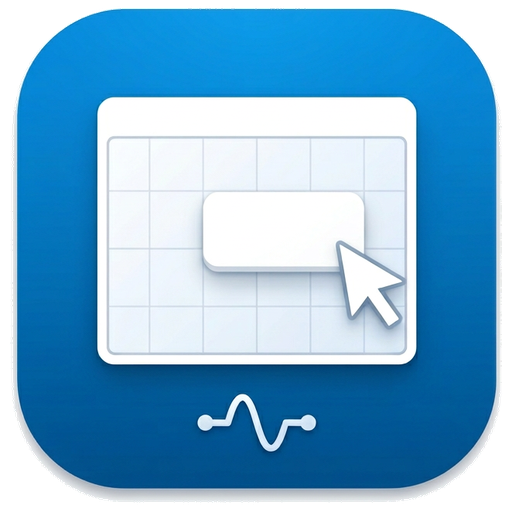
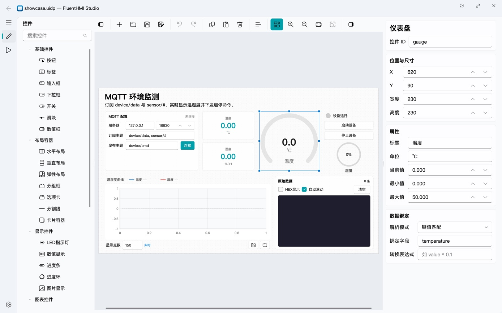
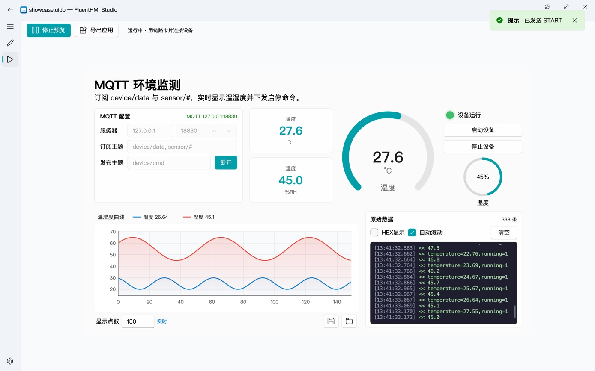
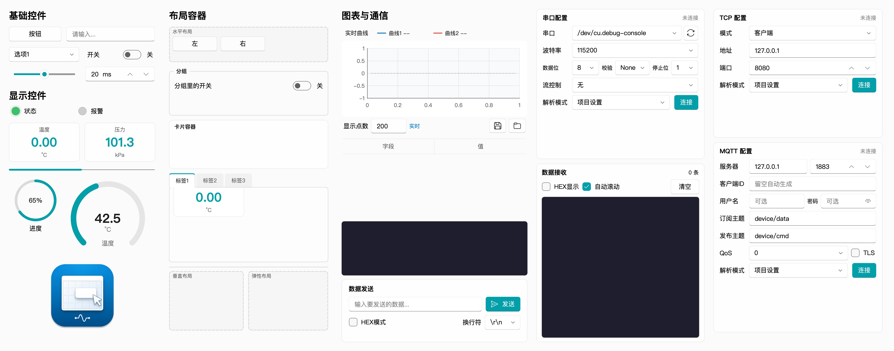
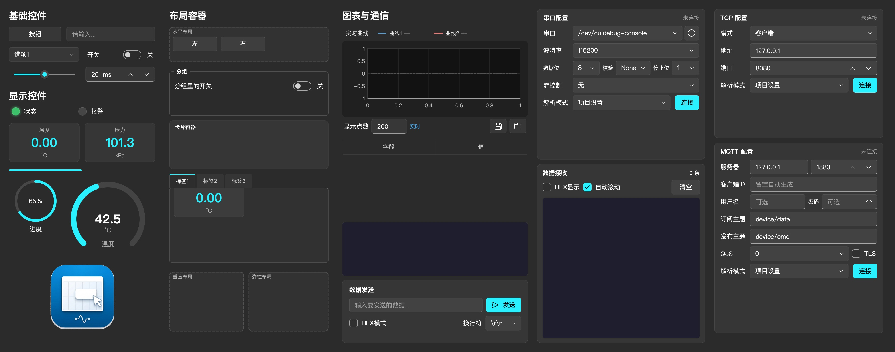

<p align="center">
  
  <h1 align="center">FluentHMI Studio</h1>
  <p align="center">面向硬件工程师的 C++ 可视化上位机设计器 · 基于 <a href="https://github.com/txp666/FluentQtWidgets">FluentQtWidgets</a></p>
  <p align="center"><a href="README.md">English</a> · 简体中文 · <a href="https://hmi.modusignal.cn/">官网</a> · <a href="https://hmi.modusignal.cn/guide/">使用说明</a></p>
</p>

FluentHMI Studio 是 [PyQt UI Designer](https://github.com/txp666/PyQt-UI-Designer) 的 C++/Qt 6 重写版：拖拽控件、配置属性、绑定串口、TCP、MQTT、UDP 或 CAN 数据，然后把设计导出成一个**不需要编译器**就能运行的独立应用。和 Python 版相比，安装包更小，启动约快一倍，导出不到一秒，还能在应用内更新（见[与 Python 版相比](#与-python-版相比)）。

## 界面预览

### 界面设计

拖拽控件到画布，在右侧编辑属性和数据绑定：

<picture><source media="(prefers-color-scheme: dark)" srcset="docs/images/designer-zh-dark.jpg"></picture>

### 预览运行

同一份工程连上设备即可实时运行，导出的应用也用同一个运行时（图中为 MQTT 模拟设备的数据）：

<picture><source media="(prefers-color-scheme: dark)" srcset="docs/images/preview-zh-dark.jpg"></picture>

### 全部控件

28 种控件在浅色和深色主题下的样子：





## 让 AI 写工程

`.uidp` 是 JSON 文件。把需求和下面这个链接一起交给 Claude、Codex 等 AI，它就能直接写出工程文件：

```text
https://raw.githubusercontent.com/txp666/FluentHMI-Studio/main/docs/uidp-format.md
```

这是 [docs/uidp-format.md](docs/uidp-format.md) 的原始文本，AI 一次就能读完，不用打开网页或克隆仓库。说明里有规则、一个完整的例子和控件一览；每个控件的全部属性在 [docs/uidp-widgets.md](docs/uidp-widgets.md)，由程序生成，说明里有它的链接，用到时再读。写完用 `FluentHMIRuntime 工程.uidp --check` 检查，再用 Studio 打开、预览和导出。

## 在浏览器里打开工程

[modusignal.cn 的“自定义设备”](https://modusignal.cn/#custom)能打开、编辑和运行同一个 `.uidp`，不用安装：串口卡片用浏览器的串口功能（Chrome、Edge），MQTT 卡片连 Broker 的 WebSocket 地址，TCP 卡片经 WebSocket 连接。CAN、UDP、图片控件和 Modbus 从站只能在 Studio 里用，导出应用也在 Studio 里做。

## 与 Python 版相比

两者使用同一种工程格式，控件和协议规则一致：

- **工程格式兼容**：直接读写 `.uidp`（版本 1.0），控件类型、属性名、默认值和枚举选项与 PyQt UI Designer 一一对应。`examples/` 里的 11 个示例工程都能打开、预览，并按原样保存。
- **解析与绑定规则一致**：行文本（键值 / JSON / CSV）、HEX 二进制帧（帧头帧尾、长度字段、校验、定长、空闲分帧）、Modbus RTU、Modbus TCP、Modbus ASCII 五种解析器，键值匹配 / JSON 路径 / HEX 字节提取 / Modbus 四种绑定，以及文本 / HEX / JSON / Modbus 四种命令编码，均按 Python 版逐条移植并有单元测试覆盖。
- **接 PLC 的 Modbus 功能一致**：本程序发出的读请求会被记下，响应里的寄存器同时按地址命名（如保持寄存器 `hr100`），绑定选寄存器区和地址；链路卡片选 Modbus 解析、控件绑定寄存器地址即可自动读取：相近的地址合并成块按周期读，一次一条，只读界面上看得见的控件，写命令排在读请求前面；16 号功能码按数据类型写入 int16、32 位整数和 float32。
- **Modbus RTU / TCP 从站**：串口、TCP、UDP 卡片可以当从站，用自己的数据表应答外部主站，绑定、控件和写命令直接读写这张表，从站寄存器表控件可以查看和修改。
- **CAN / CAN FD（仅 Studio）**：CAN 卡片连接 PEAK、ZLG、SocketCAN 或 slcan 适配器，用 DBC 文件或卡片上写的信号解码，绑定、曲线和表格照常显示；控件可以发 DBC 信号或原始报文，单次或周期发送，报文监视按 ID 列出每个报文和它的周期（见 [CAN 适配器](#can-适配器)）。用到 CAN 的工程只能在 Studio 里打开。

不同之处在实现和导出方式：

| | FluentHMI Studio 0.5.1 | PyQt UI Designer 0.5.0 |
| --- | --- | --- |
| 实现 | C++17 / Qt 6，原生编译 | Python / PyQt5（Qt 5），用 Nuitka 打包 |
| 导出应用 | 复制预编译的运行器，再放入工程和图片，约 0.3 秒，不需要 Python 和编译器 | 生成 Python 源码，再用 Nuitka 编译；下载的设计器要打包时需另装 Python 与编译工具 |
| 预览与导出 | 预览和导出的应用是同一个运行器，预览看到的就是导出后的效果 | 预览在设计器内运行，导出的是另外生成的代码 |
| macOS 安装包 | 一个 universal 包，32.7 MB（解压后 79 MB），Apple Silicon 与 Intel 通用；导出的应用同样是 universal | arm64、x64 各一个包，51.7 / 60.3 MB（arm64 版解压后 156 MB）；打包只生成本机架构的程序 |
| Windows 安装包 | 17.7 MB | 52.0 MB |
| 启动到出现窗口 | 0.7–1.1 秒 | 1.5–2.2 秒 |
| 启动后内存 | 71–85 MB | 126–137 MB |
| 更新 | 应用内检查、下载、校验并替换，可设为启动时检查 | 设置页手动检查，有新版本时打开下载页 |

安装包大小取自两者的 GitHub Release。启动和内存在同一台 Mac（Apple M5 Pro，48 GB，macOS 27.0.1）上用两个版本的 Apple Silicon 程序测得：空工程，各启动 4 次，取后 3 次（第一次分别为 2.0 秒和 3.9 秒）；内存为窗口出现 5 秒后的常驻内存。导出时间是导出 `examples/demo.uidp` 三次的耗时（0.26–0.41 秒）。

Python 版目前仍有、这里还没有的：导出可以继续修改的源码工程（见下方路线图）。

## Linux

### 安装

每个版本都有 x64 和 arm64 两种 .deb：`FluentHMI-Studio-vX.Y.Z-linux-x64.deb`（26.7 MB，安装后 91 MB）和 `FluentHMI-Studio-vX.Y.Z-linux-arm64.deb`（26.4 MB，安装后 92 MB）。可以装在 Ubuntu 24.04 及以上、Debian 13 和 Raspberry Pi OS trixie 上，这些系统的 glibc 是 2.39 及以上；Raspberry Pi OS bookworm 和大多数 RK3568 厂商镜像（Debian 11/12、Ubuntu 20.04/22.04）太旧，装不上。

```bash
sudo apt install ./FluentHMI-Studio-vX.Y.Z-linux-x64.deb
```

apt 会装好 Studio 需要的系统库。Studio 装在 `/opt/FluentHMIStudio`，从应用菜单或用 `fluenthmi-studio` 启动。启动脚本让它运行在 X11 上（Wayland 桌面下是 XWayland），除非设置了 `QT_QPA_PLATFORM`，因为无边框标题栏在那里经过验证。

### 导出的应用

Linux 上导出的是一个文件 `<应用名>.tar.gz`，拷到哪里程序都保持可执行。里面是文件夹 `<应用名>/`：程序 `<应用名>`、`start.sh`、带有 Qt 和精简系统常缺的 X11 辅助库的 `lib/` 和 `plugins/`、`qt.conf`、`project.uidp`、`appearance.json`、`assets/`，以及 `<应用名>.png`，即 256 像素的工程图标（没有设图标时是 FluentHMI 的图标）。

```bash
tar -xzf <应用名>.tar.gz
./<应用名>/start.sh
```

`start.sh` 在应用自己的文件夹里运行它；有显示环境且没有设置 `QT_QPA_PLATFORM` 时用 X11。要在同架构的另一台机器上用，把压缩包拷过去（`scp`、U 盘）再解压。那台机器需要 glibc 2.39 及以上和下面这些系统库，桌面系统都有：

```bash
sudo apt install libgl1 libopengl0 libegl1 libfontconfig1 libfreetype6 libglib2.0-0t64 libdbus-1-3 \
  libudev1 libssl3t64 libgssapi-krb5-2 libxkbcommon0 libx11-6 libx11-xcb1 libxext6 libxfixes3 libxi6 \
  libxrender1 libsm6 libice6 libxcb1 libxcb-glx0 libxcb-randr0 libxcb-render0 libxcb-shape0 \
  libxcb-shm0 libxcb-sync1 libxcb-xfixes0 libxcb-xinerama0 libxcb-xinput0 libxcb-xkb1 \
  libwayland-client0 libwayland-cursor0 libwayland-egl1
```

显示中文需要 CJK 字体；开发板镜像没有时安装 `fonts-noto-cjk`。

要让应用出现在应用菜单里，把下面的桌面项存为 `~/.local/share/applications/<应用名>.desktop`。文件名要和程序名一致，应用就是用这个名字向桌面报告自己的。在 `~/.config/autostart/` 里再放一份，登录后就会自动启动：

```ini
[Desktop Entry]
Type=Application
Name=<应用名>
Exec="/home/pi/<应用名>/start.sh"
Icon=/home/pi/<应用名>/<应用名>.png
StartupWMClass=<应用名>
Terminal=false
```

要在开机时不进桌面、直接全屏启动，可以用 systemd 服务让它运行在 eglfs 上。eglfs 通过 GPU 的 DRM/KMS 驱动绘制（用到系统的 `libdrm2`、`libgbm1`，触摸和按键用 `libinput10`）；没有 GPU 驱动时改用 `QT_QPA_PLATFORM=linuxfb`，直接画在帧缓冲上。存为 `/etc/systemd/system/<应用名>.service`，然后执行 `sudo systemctl enable --now <应用名>`：

```ini
[Unit]
Description=<应用名>

[Service]
User=pi
SupplementaryGroups=dialout video render input
Environment=QT_QPA_PLATFORM=eglfs
ExecStart=/home/pi/<应用名>/start.sh
Restart=on-failure

[Install]
WantedBy=multi-user.target
```

Studio 导出的应用只适用于它自己所在的系统，所以 Linux 应用要用同架构 Linux 上的 Studio 导出，开发板本身就可以。在那里用命令行导出；没有显示环境时（通过 SSH）在前面加上 `QT_QPA_PLATFORM=offscreen`：

```bash
fluenthmi-studio --export out 工程.uidp
```

### 串口权限

串口设备节点（`/dev/ttyUSB0`、`/dev/ttyACM0` 等）属于一个用户组，Debian、Ubuntu、Fedora 上是 `dialout`，Arch 上是 `uucp`，只有组成员能打开。Studio 或导出的应用没有权限打开串口时会提示这个组名；把当前用户加进去，然后注销并重新登录：

```bash
sudo usermod -aG dialout $USER
```

- Ubuntu 22.04 上的 `brltty`（盲文显示器服务）会抢占 CH340/CH341 USB 串口。如果 `/dev/ttyUSB0` 出现后又消失，卸载它：`sudo apt remove brltty`。
- ModemManager 会对新插入的 `ttyACM` 设备探测几秒钟，这期间串口处于占用状态。

## CAN 适配器

程序不附带任何驱动，各适配器需要：

| 适配器 | Windows | macOS | Linux |
| --- | --- | --- | --- |
| PEAK（PCAN-USB、PCAN-USB FD） | PEAK 的设备驱动（会装好 `PCANBasic.dll`） | [mac-can.com](https://mac-can.github.io/drivers/libPCBUSB.html) 的 PCBUSB 库（`libPCBUSB.dylib` 装在 `/usr/local/lib`） | 选 SocketCAN：内核自带 `peak_usb` 驱动 |
| ZLG（USBCAN-I/II、USBCAN-E-U 系列、USBCANFD） | 致远的设备驱动，以及致远“CAN(FD) 接口卡二次开发接口函数库” `zlgcan_x64` 文件夹里的 `zlgcan.dll` 和 `kerneldlls` 文件夹，放在程序旁边或旁边的 `zlgcan` 文件夹里。函数库需要 Visual C++ 2013 x64 运行库（USBCAN-I/II 还要 2008 x64 含 MFC 的运行库）。zlgcan.dll 先在系统路径里找各设备的内核 DLL，再找 `kerneldlls`；USBCAN-E-U 系列的（`USBCAN_E_64.dll` 等）函数库里没有。连接时卡片会指出缺哪个文件 | – | – |
| SocketCAN | – | – | 系统自带；接口的波特率用 `ip link` 设置（卡片上会给出命令，如 `sudo ip link set can0 up type can bitrate 500000 sample-point 0.875`） |
| slcan（CANable、CANUSB 等 Lawicel 协议的适配器） | 适配器的串口 | 适配器的串口 | 适配器的串口；只支持经典 CAN，10k–1M |

`.uidp` 里卡片、DBC 键、卡片上的信号和 CAN 命令怎么写，见 [docs/uidp-format.md](docs/uidp-format.md#接-can-总线)。

## 架构

```
src/core      fhmi_core     工程模型、控件元数据、协议解析、数据绑定、命令编码、CAN 信号 / DBC / 位时序（只依赖 Qt Core）
src/comm      fhmi_comm     Link 接口 + 串口 / TCP 客户端 / TCP 服务端 / MQTT / UDP / CAN（src/comm/can：PCAN、ZLG、SocketCAN、slcan），CommHub 汇总所有链路
src/runtime   fhmi_runtime  基于 FluentQtWidgets 的运行时控件、RuntimeSurface、绑定引擎
src/designer  fhmi_designer 画布（QGraphicsScene）、控件面板、属性编辑器、对齐与容器嵌套
src/studio    FluentHMIStudio   设计器应用：界面设计 / 预览运行 / 设置，导出服务
src/player    FluentHMIRuntime  导出应用的运行器：读取自身旁边（或 .app 内）的 project.uidp 和 appearance.json
tools         uidp_reference    从控件注册表重新生成 docs/uidp-widgets.md 和 docs/uidp-format.md 末尾的控件一览
```

设计画布上显示的就是真实的运行时控件，套在 QGraphicsProxyWidget 里且不响应鼠标。预览和导出应用把同一批控件挂到 RuntimeContext 上，由它接收链路数据、执行绑定、发送命令。

## 构建

需要 CMake 3.21+、C++17、Qt 6.12（Core、Gui、Widgets、Svg、Network、SerialPort）。Qt 装在 Qt 安装器或 aqtinstall 的默认位置（`~/Qt`、`C:\Qt`）时会被自动找到；装在其他位置时，用 `-DCMAKE_PREFIX_PATH=<Qt 目录>` 指定。Linux 上还要安装 `libgl1-mesa-dev`、`libxcb-cursor0` 和 `libxkbcommon-x11-0`。

```bash
git clone --recursive https://github.com/txp666/FluentHMI-Studio.git
cd FluentHMI-Studio
cmake --preset debug
cmake --build --preset debug
ctest --preset debug
```

在 VS Code 中打开本目录，Ctrl/Cmd+Shift+B 构建，F5 构建并启动 Studio。Windows 上要从 Visual Studio 的 Developer PowerShell 启动 VS Code，CMake 才能找到编译器；第一次按 F5 前，在“运行和调试”里选 “Debug FluentHMI Studio (Windows, MSVC)”。

macOS 运行 `open build/debug/FluentHMIStudio.app`，Linux 运行 `build/debug/FluentHMIStudio`。无界面导出：

```bash
FluentHMIStudio --export <输出目录> <工程.uidp>
```

导出的应用以导出时 Studio 设置页的主题（浅色、深色或跟随系统）、主题色和语言启动，与预览一致；这三项写在应用内工程旁的 `appearance.json` 里，无界面导出用 Studio 保存的设置。运行器直接打开工程时仍用自己保存的设置。

设置页的“语言”可选跟随系统、简体中文或 English，重启 Studio 后生效。跟随系统时，中文系统显示简体中文，其他系统显示英文；导出的应用设为跟随系统时，跟随它所在电脑的系统语言。

运行器可以把整个工程画面渲染成图片，`docs/images` 里的控件一览就是这样生成的：

```bash
FluentHMIRuntime <工程.uidp> --theme dark --screenshot widgets-dark.png
```

## 在线更新

Studio 从本仓库的 GitHub Release 获取更新。设置页有"检查更新"按钮和"启动时检查更新"开关（默认开启；启动检查只在发现新版本时弹窗，网络错误不打扰）。发现新版本时显示更新说明，可以立即更新、跳过此版本或以后再说。

立即更新会下载本平台的安装包（`-macos-universal.zip` / `-windows-x64.zip`），用 Release 里的 `.sha256` 校验大小和 SHA-256，解压到安装目录旁边的 `.fluenthmi-update` 文件夹。之后点"重启并更新"，或者稍后退出 Studio 时，一个小的辅助脚本（macOS 用 sh，Windows 用 PowerShell）会等 Studio 退出、把旧版本移开、换上新版本、按需重新启动，最后删掉旧版本；换不上时恢复旧版本，下次启动会提示原因。从构建目录运行、macOS 从隔离的临时位置运行、或者没有写入安装目录的权限（例如装在 Program Files）时，不会自动更新，改为打开下载页。

Linux 上的安装包是 .deb（`-linux-x64.deb` / `-linux-arm64.deb`），同样校验，原样保存在 `~/.cache/FluentHMI/FluentHMI Studio/update`。Studio 退出时，pkexec 会要求输入管理员密码；之后以 root 身份把安装包复制到自己的目录，重新校验副本的 SHA-256，确认它是适用于本机架构的 FluentHMI Studio，等 Studio 退出，再用 `apt-get` 安装。需要时以你的身份（不会以 root）重新启动 Studio；安装失败时旧版本保持不变，下次启动会提示原因。这要求 Studio 是从 .deb 装在 `/opt/FluentHMIStudio` 的，并且系统有 pkexec 和 apt-get；否则改为打开下载页。

无界面更新，安装包会在这个进程退出后被替换：

```bash
FluentHMIStudio --update
```

测试更新流程时，可以用 `FHMI_UPDATE_URL` 指向本地服务器上与 GitHub "latest release" 接口格式相同的 JSON。

## 打包与发布

```bash
cmake --preset release && cmake --build --preset release
python3 scripts/package.py --build-dir build/release --output-dir dist
```

macOS 生成 `FluentHMI Studio.app`，运行器位于 `Contents/Helpers/FluentHMIRuntime.app`；Windows 生成 `FluentHMI-Studio/`，Studio 和运行器两个 exe 在同一目录；Linux 生成一个 .deb，把同样的平铺目录装成 `/opt/FluentHMIStudio`，Qt 的库在 `lib/`，插件在 `plugins/`，另有启动脚本 `/usr/bin/fluenthmi-studio`、桌面项和图标。包里只有一份 Qt：macOS 上 Qt 放在运行器里，Studio 通过 rpath 和 `qt.conf` 使用它；Windows 和 Linux 上两者共用目录里的 Qt 库和插件，`runtime-files.txt` 记录运行器需要的文件。Linux 上两个程序通过 RUNPATH（`$ORIGIN/lib`，用 patchelf 设置）找到 `lib/`，精简系统常缺的 X11 辅助库和 Qt 的库放在一起，所以导出的应用在什么都没装的系统上也能运行。导出应用时只复制运行器及其 Qt，导出的应用因此可以直接拷到别的电脑上运行。脚本最后会用打包好的 Studio 导出 `examples/demo.uidp`，再以 `--check` 启动导出的应用，任何一步失败都不会产出压缩包。在 macOS 上它还会检查没有任何库仍从构建机的 Qt 目录加载，并用 `DYLD_PRINT_LIBRARIES` 确认 Studio 和导出的应用运行时只加载系统库和包内的库。Linux 上用 RUNPATH 和 `ldd` 做同样的检查（不能缺任何库），运行时用 `LD_DEBUG=libs`，检查的是从做好的 .deb 解出的 Studio，以及从 tar.gz 解出、用 `start.sh --check` 启动的导出应用；它启动的程序需要显示环境，所以要在 `xvfb-run -a` 下或桌面会话里运行。产物为 zip 加 `.sha256`（Linux 上是 .deb 加 `.sha256`）；macOS 只做了 ad hoc 签名，没有 Developer ID 签名和公证。

发布新版本：修改 `CMakeLists.txt` 中 `project(... VERSION ...)`，可选地添加 `docs/release-notes/vX.Y.Z.md`，然后推送 `vX.Y.Z` 标签。`Release` 工作流会在 Windows、macOS（universal）和 Linux（x64 和 arm64，在 Ubuntu 24.04 上）上构建、测试、打包。对每个 .deb，它检查包名、版本、架构和依赖，让 apt 解析依赖，安装后用它导出示例工程，再在只装了上面所列系统库的干净 Ubuntu 24.04 容器里运行这个导出的应用。全部通过后才发布 GitHub Release。手动运行，或者由修改了打包的 pull request 触发时，只打包和检查，不发布。

## 当前状态（0.5.1）

已完成：全部 32 种控件、拖拽设计、网格吸附、缩放、对齐与分布、撤销 / 重做、复制 / 粘贴（剪贴板格式与 Python 版互通）、容器嵌套（水平 / 垂直 / 弹性 / 卡片 / 选项卡）、属性与数据绑定编辑、保存 / 打开 / 另存为（相对图片路径随工程目录迁移）、串口 / TCP / MQTT / UDP / CAN 预览、导出独立应用（可用工程自己的图标）、实时曲线的完整历史记录、游标和 CSV/JSON 保存 / 加载对比、Windows、macOS 与 Linux（x64、arm64 .deb）打包、浅色 / 深色主题、全部 Fluent 风格滚动条、在线更新（检查、下载校验、替换并重启）、按地址命名的 Modbus 绑定与自动轮询、带长度字段和校验的二进制帧、可配结束符和编码的文本解析、Modbus ASCII。

MQTT 链路是自带的 MQTT 3.1.1 客户端（基于 QSslSocket，无需 Qt MQTT 模块）：支持用户名密码、QoS 0/1/2、`+`/`#` 通配符订阅，TLS 使用系统证书库；连接成功后若断开会自动重连。与 Python 版一致，每条消息视为一帧，纯数值载荷还会以主题名为键再给出一份。

已在 macOS 上做过端到端验证：TCP 和 MQTT 模拟设备的数据显示、曲线和命令下发，导出应用的运行，以及在本机打包后解压运行。Windows 包在发布工作流（Windows Server 2022）中做导出自检，并在 Windows 11 ARM64 虚拟机上（x64 仿真）验证过解压运行、导出和导出应用的运行。尚未验证的：连接真实 MQTT broker 和 TLS。CAN 用模拟的 slcan 适配器做过端到端验证，用户在真实总线上用过 PCAN-USB；ZLG 和 SocketCAN 适配器还没有在真实硬件上确认过。

路线图：

- 导出 C++/CMake 源码工程，供需要二次开发的用户使用
- Developer ID 签名与公证、Windows 代码签名

## 许可

GPL-3.0，与 FluentQtWidgets 和 PyQt UI Designer 保持一致。
