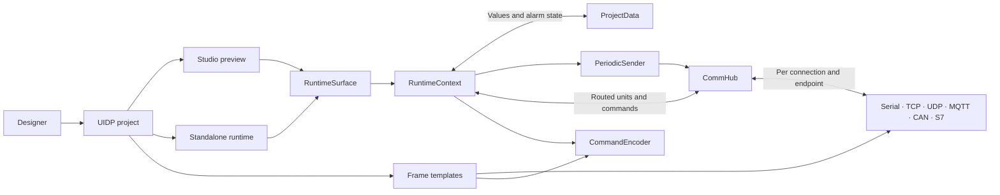

# FluentHMI Studio v0.9 架构 / Architecture

[使用手册](guide.zh.md) · [User guide](guide.en.md) · [Build from source](build.en.md#build-from-source)

## 工程与运行 / Project and runtime

设计器保存 UIDP 工程、帧模板和工程数据定义。运行预览在 Studio 内加载该工程，独立应用用随包的 FluentHMIRuntime 加载工程。两者共用 `RuntimeSurface`、控件和通信逻辑。导出把工程、资源与运行器打包。

The designer saves the UIDP project, frame templates, and data definitions. Preview and the exported runtime both construct the same `RuntimeSurface` from it. The exported application carries its runtime and assets.

## 收发路径 / Receive and send paths

| 阶段 / Stage | 行为 / Behaviour |
| --- | --- |
| 连接 / Link | 串口和网络链路根据来源流分帧，TCP 对端和 MQTT 主题各自保留边界或解析状态。模板组按帧头或命令字识别候选。 / Stream-specific framing preserves source information. Template groups select a layout by header or command bytes. |
| 接收 / Receive | `Link` 交付原始报文和解析结果。`CommHub` 保留连接与子通道标识，运行时用同一帧里的值更新工程点后再求值报警。 / Parsed units retain their connection and endpoint. Point updates from a frame are applied before alarm evaluation. |
| 取值 / Binding | 显示、曲线、记录与发送可引用同一工程点。源冲突、旧值和换算失败用质量状态表示。 / Displays, curves, records, and sends can share points with source and quality information. |
| 发送 / Send | 发送预览与运行时使用 `CommandEncoder`。运行时解析目标、处理可选确认，再交给通信链路。`PeriodicSender` 管理重复发送及停止，按需要重新读取输入。 / Preview and runtime share the encoder. Runtime resolves routing and confirmation, then dispatches. Periodic jobs refresh inputs and can be stopped across pages. |
| 显示与记录 / Display and capture | 数据接收卡按 40 ms 批量更新可见日志，数据帧按到达解析。CAN 后台会话处理适配器 I/O，CAN 监视批量刷新，`CanRecorder` 分段写 CSV。 / The receive card batches display updates on a 40 ms timer. CAN monitor rendering and CSV recording have separate paths. |

## 源码入口 / Source map

| 路径 / Path | 职责 / Responsibility |
| --- | --- |
| `src/core` | UIDP、控件注册表、帧解析、字段绑定、编码与 CAN 信号 / UIDP, widget registry, parsing, binding, encoding |
| `src/comm` | 连接、对端、Modbus、MQTT、经典 S7、CAN 会话和适配器 / Transports, endpoints, protocol clients, CAN sessions |
| `src/runtime` | 运行界面、共用数据、报警、周期任务与记录 / Runtime surface, project data, alarms, periodic jobs, recording |
| `src/designer` | 画布、属性区、可视化协议和发送编辑器 / Canvas, properties, frame and command editing |
| `src/studio` | 设计、预览、设置、导出与更新 / Studio UI, export, update |
| `src/player` | 已导出应用的入口和窗口 / Standalone application entry and window |
| `tools/uidp_reference.cpp` | 从注册表生成控件属性参考 / Generates the widget reference and index |

当改动涉及项目字段时，同时检查加载、保存、设计器编辑、运行预览与导出应用。公开字段名以 [UIDP 参考](uidp-format.md) 和 [控件注册表生成的属性表](uidp-widgets.md) 为准。检查命令见 [构建与文档生成](build.zh.md#从源码构建)。

For a project field change, check load, save, designer editing, Preview, and the exported runtime. Regenerate the [widget reference](uidp-widgets.md) when metadata changes. See [build and documentation checks](build.en.md#build-from-source).
