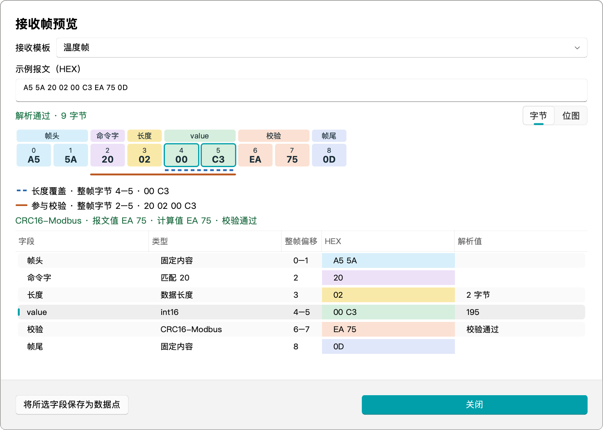
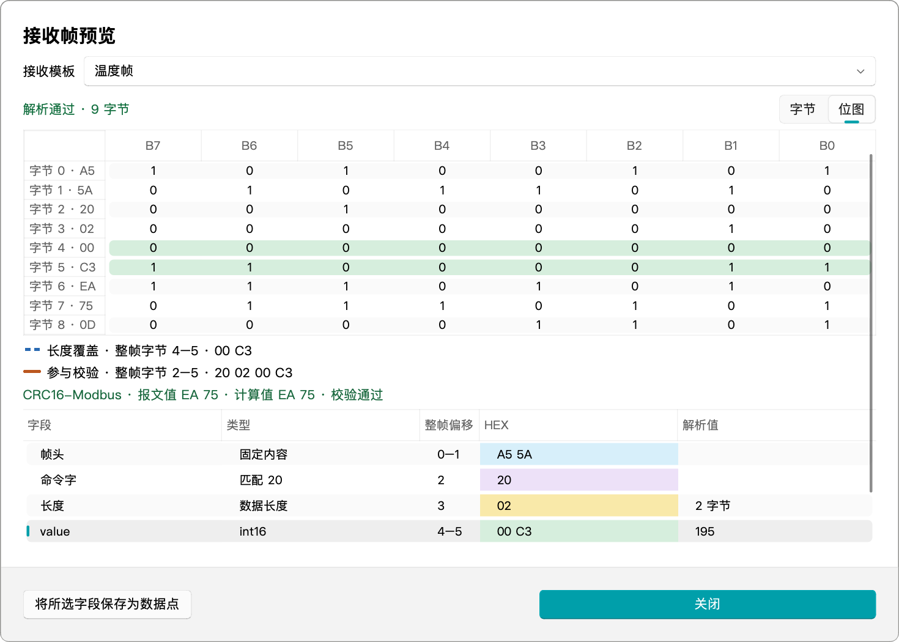

# Series 17 data and frame labs

[简体中文](17-frame-io.zh.md) · [v0.9 user guide](../guide.en.md) · [Project files](../../examples/tutorials/README.md)

Use Studio v0.9.1 or later with these UIDP 1.3 projects. Start with 17 for a complete command and readback round trip. Use 17.1–17.2 for text and JSON, 17.3–17.5 and 17.8 for binary framing, and 17.9–17.10 for mixed frames. Several project labels are in Chinese. A label or button's name in the project does not change the configured protocol.

For TCP exercises, start Preview and connect the simulated server on the right before the HMI client on the left. If a port is occupied, change both cards to the same free port before connecting. UDP exercises pair each card's destination with the other card's local port. Confirm a send when prompted.

Open the Preview page from the left sidebar and click **Run Preview**. Each project starts with two steps that identify the connections, editable values, and expected display. Use **Project data monitor** in the preview toolbar to inspect values, sources, data quality, and sample times. Open **Data and alarms → Data points** in the designer to inspect the bindings.

## 17 Share one frame template

Open [17 Data I/O and frame templates](../../examples/tutorials/17-数据收发与帧模板.uidp). The TCP cards use `127.0.0.1:39172`. Under **Data and alarms → Frame templates**, inspect the speed template and paste `AA 55 03 10 DC 05 99 66 0D`.

| Whole-frame bytes | HEX | Meaning |
| --- | --- | --- |
| 0–1 | `AA 55` | Header |
| 2 | `03` | Three bytes of data, including the command |
| 3 | `10` | Command `cmd`, default decimal `16` |
| 4–5 | `DC 05` | Required `rpm`, little-endian uint16, `1500` |
| 6–7 | `99 66` | CRC16-Modbus in little-endian order |
| 8 | `0D` | Footer |

The checksum covers `03 10 DC 05`, at whole-frame bytes 2–5. The `rpm` field has offset `2` after the header and starts at byte `4` in the whole frame.

1. In **Data points**, check the two speed readings. The feedback point reads `rpm` from `hmi`. The device target reads the same template field from `device`.
2. Select **发送转速** (Send speed) in the designer and open Edit send configuration. It uses the speed template, the template default for `cmd`, and the speed input for `rpm`. The line edit uses the same template and selects `rpm` as its send field.
3. Run Preview and connect both sides. Confirm a send with `1500`. The device shows `1500`. Click **回送设备反馈** (Return device feedback) and confirm to see `1500 rpm` at the HMI and one chart sample.
4. Enter `2300` in the speed input and press Enter. Confirm and repeat the device feedback. Check the log, chart, and records. The device command and HMI feedback are separate messages.

| Operation | Expected frame |
| --- | --- |
| Send 1500 | `AA 55 03 10 DC 05 99 66 0D` |
| Return 1500 | `AA 55 03 11 DC 05 C8 A6 0D` |
| Send 2300 | `AA 55 03 10 FC 08 41 63 0D` |
| Return 2300 | `AA 55 03 11 FC 08 10 A3 0D` |

Clear the input and try Enter to see the required-field check. Inspect a received row and change `99` in the CRC to `98` to compare the received and calculated values. In a project copy, rename `rpm` to `shaft_rpm` to review affected references before confirming.

## 17.1 Text and CSV

[Open 17.1](../../examples/tutorials/17.1-文本键值与CSV.uidp) · TCP `39173`

1. Send the key-value command. The device reads speed `720`, temperature `-12.5`, and state `1` from `rpm:720;temperature:-12.5;state:1\r\n`.
2. Return speed and temperature. Send the separate CSV button and check that `720;-12.5\r\n` yields `ch0` and `ch1`.
3. Enter `810` in the speed line edit. Confirm that only `rpm:810\r\n` is sent. Start the 500 ms key-value and 1200 ms CSV tasks, change the speed to `910`, then stop just the key-value task in Periodic tasks. The CSV task continues until stopped.

## 17.2 UDP and nested JSON

[Open 17.2](../../examples/tutorials/17.2-UDP嵌套JSON.uidp) · HMI `39174`, device `39175`

1. Send the sample. The device reads speed `1500`, Boolean `true`, and the last sample `24.25` via `telemetry.samples.-1`.
2. Return the values and check `readback.0` and `readback.1`. Enter `false` in the readiness input to send `{"telemetry":{"ready":false}}`.
3. Start the 1000 ms task to send the complete nested object repeatedly. Inspect the JSON paths in the device's receive card.

## 17.3 Fixed length and CRC8

[Open 17.3](../../examples/tutorials/17.3-固定长度与CRC8.uidp) · TCP `39176`

1. Assemble and send `5A A5 21 FF 83 00 00 C0 3F 00 01 11 70 E6`. Verify `-12.5 °C`, gain `1.50`, and count `70000`. The fields use big-endian int16, little-endian float32, and big-endian uint32.
2. Inspect the sample, change the last byte to `E7`, and compare the CRC values. Bytes 2–12 are covered. Start the 500 ms template task, review the input values in the confirmation, and stop it after several frames.

## 17.4 Footer framing and XOR

[Open 17.4](../../examples/tutorials/17.4-帧尾分帧与异或.uidp) · TCP `39177`

1. Press Enter with payload `21 41 42 43 DE AD`. The template sends `7E 21 41 42 43 DE AD 12 0D 0A`, which shows `ABC`, `DE AD`, and command 33.
2. Set the extension to `1000` and send the longer frame. This appends the big-endian extension `03 E8` to the current payload and recalculates XOR. Change the payload to `22 58 59 5A 12 34` and send again to see `XYZ`. A later short frame leaves the extension at the last value received in a long frame.

## 17.5 Two-byte length and CCITT

[Open 17.5](../../examples/tutorials/17.5-双字节长度与CCITT.uidp) · TCP `39178`

1. Assemble the frame. Verify the total length `20 B`, position `-123456`, offset `-7`, and ratio `1.25`.
2. In the template preview, `14 00` is a two-byte little-endian length for the whole frame. The checksum covers from the length field and is written as `FD 61` in big-endian order.

## 17.6 Mixed Modbus registers

[Open 17.6](../../examples/tutorials/17.6-Modbus混合寄存器.uidp) · Modbus TCP `39179`, unit `1`

1. Connect the slave and master. Observe HR100 at `100`, IR10 at `253`, and the values in coil 0 and DI0. Wire bytes show the read request and reply for each area.
2. Enter `321` in the Kp input and confirm FC06. HR100 updates and the master reads it back.
3. Set Kp to `400` and send FC16 to addresses 100–103. The confirmation lists Kp `400`, Ki `0.25` and Kd `-12`. Register words are `0190 3E80 0000 FFF4`. The float occupies addresses 101–102.
4. Toggle coil 0 on and off with FC05, checking readback after each step. In a project copy, select RTU on both TCP cards to compare its CRC with the TCP framing above.

## 17.7 Virtual CAN and CAN FD

[Open 17.7](../../examples/tutorials/17.7-CAN经典帧与FD信号.uidp) · [View and bind CAN signals on the bit map](can-bit-map.en.md)

1. Connect the **Virtual CAN** adapter. It loops transmitted frames back into receive processing on the same card.
2. Click the standard-frame button or press Enter with speed `1800` to send `321#0807A0FE01000000`. The frame also carries the fixed temperature `-35.2 °C` and ready bit `1`. Change speed to `2250` and send again. The loopback reading and its project data point follow the new value.
3. Set the pressure input to `325` and send the extended FD+BRS frame `0x18FF0055`. Its 12-byte payload starts with `01 45`; the Motorola MSB field reads `3.25 bar`. Start the 500 ms standard-frame task and change the speed to `2500` while it runs. Stop it from the original button or **Periodic tasks**.
4. Use the manual send card for `00000321#11223344` and `321#R8` to compare an extended data frame with an RTR request.
5. Try the CAN monitor's scrolling and per-ID views, filters, and saved display preferences. Virtual CAN exercises layout and binding. An adapter is needed to validate physical bus timing.

## 17.8 Idle-gap framing and sum

[Open 17.8](../../examples/tutorials/17.8-空闲分帧与和校验.uidp) · TCP `39180`

1. Enable Wire bytes and send `C3 7F 05 2E FB AD`. After a 150 ms idle interval, the receiver delivers `-1234` on channel `5`. The low byte of `7F + 05 + 2E + FB` is `AD`.
2. Send `256`. The new frame is `C3 7F 05 00 01 85`. The 600 ms task leaves a gap between frames. Stop it and check that the receive count settles.

## 17.9 Several commands in one frame format

[Open 17.9](../../examples/tutorials/17.9-同连接多种HEX帧.uidp) · TCP `39181`

All three messages share `AA 55`, a one-byte data length, and CRC8. Each project data point uses its command prefix to select the corresponding bytes. The displays read those points.

1. Set speed to `2100` and send command `0x10`. The left side shows `2100 rpm`. Set raw temperature to `-185` and raw pressure to `416` and send their frames. Verify `-18.5 °C` and `4.16 bar`. Status codes `0`, `1`, and `2` mean stopped, running, and fault.
2. Send the fixed three-frame sample. The receiver delivers three independent records and reads `2300 rpm`, `19.5 °C`, `3.75 bar`, and running.
3. Turn on **Wire bytes** and send the bad CRC example. The invalid frame appears in the diagnostic log while the speed value stays at its last accepted reading.
4. Send `AA 55 03 10`, then `DC 05 C5`. The second write completes the speed frame and displays `1500 rpm`.

## 17.10 Mixed receive templates

[Open 17.10](../../examples/tutorials/17.10-同连接多接收模板.uidp) · TCP `39182`

1. Connect the right and left cards in Preview. Send the three frames with the initial inputs. The displays show `1800 rpm`, `-12.5 °C`, `2.50 bar`, and fault.
2. Change the right-side inputs to `2300`, `195`, `375`, and `1`. Send the batch again to read `2300 rpm`, `19.5 °C`, `3.75 bar`, and running. You can also send each frame separately. Press Enter in the speed field with `1800` to send `A5 5A 10 08 07 1F`.
3. Start the 1000 ms mixed send. Change any input during the run and see the next cycle use the current value. Clear a required field to see a skipped cycle, restore it, then stop the task in **Periodic tasks**.
4. Open **Project data monitor**. The four points use `speed.value`, `temperature.value`, `status.value`, and `status.state`. Enable **Wire bytes** and try the two recovery samples. The invalid frame is rejected and the valid speed frame that follows is delivered.

Select the periodic button in the designer and open **Edit mixed send** to inspect the pressure/status, temperature, and speed templates in send order. Each frame reads its assigned inputs and calculates its length and checksum. Open the HMI TCP card's parse preview to switch templates or paste a frame to match it automatically. To try changing connections, use a project copy and select the speed template alone. The impact list shows the retained reference changing from `speed.value` to `value`.

The preview shows the raw temperature field `195`. The project point scales it by `value * 0.1` to display `19.5 °C`.

Switch to **Bit map** in Parse preview. Click a bit in byte `4` or `5` to select the `value` row in the field table. Select `value` to highlight all 16 bits. The length and checksum coverage remains visible below the grid.

| Template | Match | Framing and checksum |
| --- | --- | --- |
| Speed | `A5 5A` with command `10` at byte 2 | Fixed 6 bytes and CRC8 |
| Temperature | `A5 5A` with command `20` at byte 2 | Length at byte 3, CRC16-Modbus, footer `0D` |
| Pressure status | `7E 7F` | Footer `0D 0A` and XOR |

## 17.11 Virtual serial

[Open 17.11](../../examples/tutorials/17.11-串口收发与数据发送卡.uidp)

1. Connect Virtual serial A and B in Preview. On the left send by template field with sequence `1` and sample `-100`. The frame preview shows `D5 5D 00 05 01 FF 9C 0D 0A`. Confirm to update the project data points on the right.
2. On the right start the 700 ms task with sequence `2` and sample `250`. Open the field editor during the run and apply `3` and `-100`. The left display updates on the next cycle. Stop it from the send card or **Periodic tasks**.
3. Try the same exercise using HEX payloads `01 FF 9C`, `02 00 FA`, and `03 FF 9C`. The two-byte big-endian length counts three payload bytes and the two footer bytes. This template uses no checksum.

## 17.12 MQTT topics

[Open 17.12](../../examples/tutorials/17.12-MQTT发布订阅与主题取值.uidp) · Public broker `broker.emqx.io:1883`

1. Connect both MQTT cards. The app replaces the `{session}` topic segment for this run and shows the effective topics on the cards.
2. Publish `900` by pressing Enter. Return A's feedback from the device card. The fixed comparison button for B returns `1234`. The two project data points distinguish the same `rpm` key by topic.
3. Start A's 1000 ms feedback task. Change and publish the target to `2300`. The next feedback uses that value. Inspect and stop the job in **Periodic tasks**.

This exercise sends its sample values to the public broker. You can set both cards to a broker you control to practice on a local network. [EMQX public broker](https://www.emqx.com/en/mqtt/public-mqtt5-broker)
