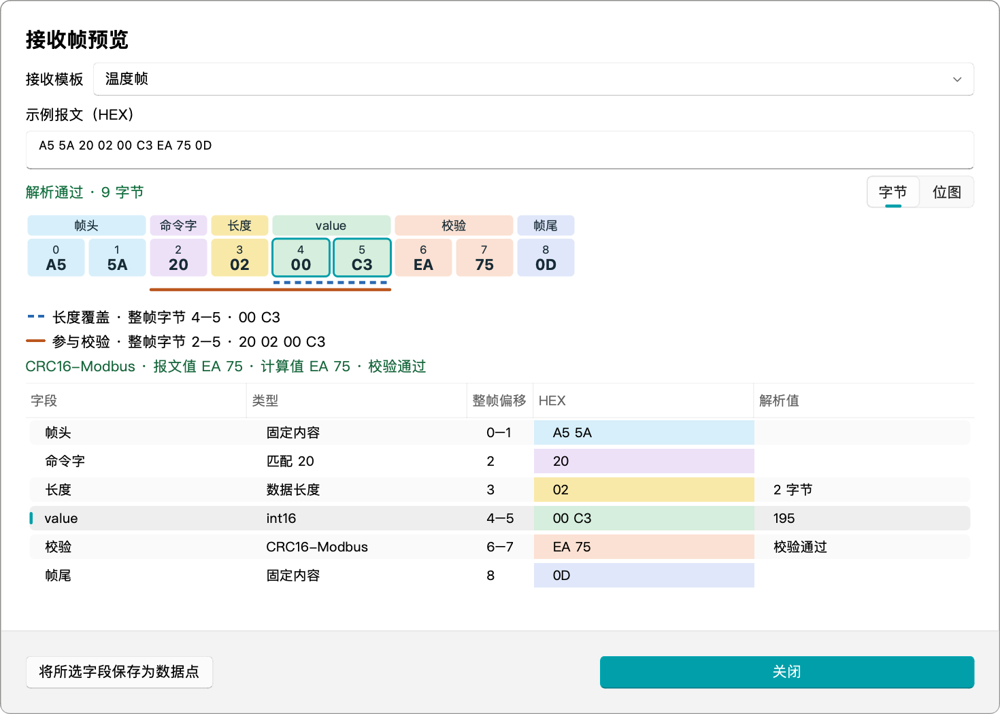
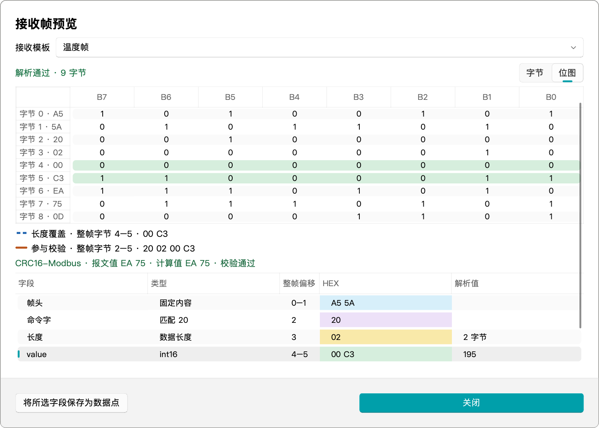

# 17 系列收发实训

[English](17-frame-io.en.md) · [v0.9 使用手册](../guide.zh.md) · [教程工程索引](../../examples/tutorials/README.md)

使用 FluentHMI Studio v0.9.1 或更新版本打开本页的教程工程。

第一次使用，从 **17** 走完「连接 → 发送 → 设备回送 → 显示与记录」。接着用 **17.1** 学文本回车、按钮多值和两个独立周期，用 **17.2** 学 JSON。做二进制协议时，从 **17.3–17.5、17.8** 选一种分帧方法，再用 **17.9、17.10** 练同一连接混收。需要特定链路时，直接选对应的工程。

打开工程后，先切到左侧「预览运行」，再点「运行预览」。画布顶部写明连接顺序、从哪里改值以及在哪里核对结果。运行中点工具栏的「工程数据监视」，可查看每个工程数据点的当前值、来源、数据质量和采样时间。想看配置时，回到设计器，从「数据与报警 → 数据点」打开该点的绑定。

| 工程 | 在运行预览中练习 | 线路与格式 | 接收端核对 |
| --- | --- | --- | --- |
| [17 入门](#17-入门共用一份帧模板) | 输入框回车、按钮确认、设备回送 | TCP，1 字节数据长度、CRC16-Modbus、帧尾 | 数据点、曲线、记录表 |
| [17.1 文本键值与 CSV](#171-文本键值与-csv) | 回车单值、多输入按钮、500 ms 和 1200 ms 两个周期 | TCP，UTF-8、分号、CRLF | 键值、CSV 列、状态枚举、停止所选 |
| [17.2 UDP 嵌套 JSON](#172-udp-嵌套-json) | 回车更新布尔值、按钮组 JSON、1000 ms 周期 | UDP，UTF-8 JSON、LF | 对象、数组、布尔值、回送 |
| [17.3 固定长度与 CRC8](#173-固定长度与-crc8) | 一键组帧、500 ms 模板周期 | TCP，固定 14 B、CRC8 | 混合端序、换算表达式、校验失败 |
| [17.4 帧尾分帧与异或](#174-帧尾分帧与异或) | 回车发 HEX 载荷、按钮发长帧 | TCP，帧尾 `0D 0A`、异或 | ASCII、HEX 字段、可选扩展字段 |
| [17.5 双字节长度与 CCITT](#175-双字节长度与-ccitt) | 多输入按钮、可视化定位长度和校验 | TCP，2 字节小端整帧长度、CRC16-CCITT | int32、int8、float64 |
| [17.6 Modbus 混合寄存器](#176-modbus-混合寄存器) | 回车 FC06、开关 FC05、按钮 FC16 | Modbus TCP，可练 RTU over TCP | 四个表区的轮询、寄存器范围和类型 |
| [17.7 CAN 经典帧与 FD](#177-can-经典帧与-fd-信号) | 回车赋信号、按钮单发和 500 ms 周期、手工发送卡 | CAN 标准与扩展数据帧、RTR、FD+BRS | 位信号、ID 筛选、滚动与汇总 |
| [17.8 空闲分帧与和校验](#178-空闲分帧与和校验) | 回车、按钮、600 ms 周期 | TCP，空闲 150 ms、和校验 | 线路字节和交付时机 |
| [17.9 同连接多种 HEX 帧](#179-同连接多种-hex-帧) | 改值发单帧、用固定样例练粘包与拆包 | TCP，共用长度规则、三种命令字、CRC8 | 工程数据点按命令字取值、半帧重组、CRC 拒收 |
| [17.10 同连接多接收模板](#1710-同连接多接收模板) | 回车按字段组帧、混发、周期内修改四项输入 | TCP，定长、长度字段、帧尾三种规则 | 同名字段隔离、粘贴匹配、坏帧恢复、切换迁移 |
| [17.11 串口收发与数据发送卡](#1711-串口收发与数据发送卡) | 按字段或 HEX 载荷发送、700 ms 周期内改值 | 内置虚拟串口，2 字节大端长度，长度包含帧尾 | 双向工程数据点、序号与有符号采样 |
| [17.12 MQTT 发布订阅与主题取值](#1712-mqtt-发布订阅与主题取值) | 回车发布、按钮回送、1000 ms 周期 | EMQX 公共 Broker，MQTT QoS 1，每条消息单独解析 | 主题路由、同名键按来源区分 |

运行时先区分三种动作。标明「回车」的输入框直接发送当前值。多参数示例里的「仅输入」框提供值，统一由旁边的按钮发送。周期运行时改输入，下一轮自动读取当前值。启用了下发确认的示例要点「确认发送」。

## 17 入门共用一份帧模板

打开 [17-数据收发与帧模板.uidp](../../examples/tutorials/17-数据收发与帧模板.uidp)。工程采用 UIDP 1.3。两张 TCP 卡在同一个工程中扮演上位机和模拟设备，使用本机地址 `127.0.0.1`，端口为 `39172`。

### 1. 查看共享帧格式

点设计器顶部「数据与报警 → 帧格式模板」，选中「转速帧」并点「编辑所选」。样例 `AA 55 03 10 DC 05 99 66 0D` 会通过解析。整帧按下表解读。

| 整帧字节（从 0 开始） | 样例 HEX | 含义 |
| --- | --- | --- |
| 0–1 | `AA 55` | 帧头 |
| 2 | `03` | 后续数据占 3 字节 |
| 3 | `10` | `cmd`，`uint8`，默认发送值为十进制 `16` |
| 4–5 | `DC 05` | `rpm`，小端 `uint16`，样例为 `1500`。发送时必填 |
| 6–7 | `99 66` | CRC16-Modbus，结果按小端写入 |
| 8 | `0D` | 帧尾 |

橙线覆盖整帧字节 2–5，即 `03 10 DC 05`。模板里的**字段偏移**从帧头后算，`rpm` 在模板字段表里的偏移是 `2`，在整帧中的位置是 `4–5`。

### 2. 查验接收绑定和发送配置

1. 回到「数据与报警 → 数据点」。在「反馈转速」右侧点「设置绑定…」，再点「可视化取值…」。当前字段是 `rpm`，来源连接为 `hmi`。用同样入口检查「设备收到的目标」，它从 `device` 读取同一个字段。
2. 回到画布，选中「发送转速」按钮，打开「操作与发送 → 编辑发送配置」。发送帧模板为「转速帧」，载荷来源为「按字段填写」。`cmd` 沿用模板默认值，`rpm` 取自「目标转速」输入框。底部预览会自动生成长度和 CRC。
3. 选中「目标转速」输入框。它也使用「转速帧」，「发送字段」是 `rpm`。点击按钮和在该输入框按回车都可以发一帧，并各自弹出确认。

### 3. 连接本机模拟设备

点击「预览运行 → 运行预览」。先点**右侧**模拟设备的「连接」启动服务端，再点**左侧**上位机的「连接」。右侧应显示 `1 台设备`，两卡的解析模式应为「模板 · 转速帧」。如果端口已占用，连接前把两边改成同一个空闲端口。

### 4. 发送目标并查看回读

1. 保留目标转速 `1500`，点「发送转速」。核对目标连接、`rpm = 1500` 和完整 HEX，点「确认发送」。右侧「设备收到的目标」变为 `1500`，左侧反馈仍等待设备回送。
2. 点右侧「回送设备反馈」，确认发送。回送按钮从工程数据点取刚收到的转速，并把 `cmd` 覆盖为十进制 `17`。左侧出现 `1500 rpm`，曲线出现第一个采样点。
3. 把目标改为 `2300` 并按回车。确认后右侧变为 `2300`。再次回送后，左侧也变成 `2300`，曲线有两个采样值。点「工程数据监视」可以核对双方的数据源和采样时间。
4. 右侧「收发报文」首次打开使用「自动显示」，本例的二进制帧会显示为 HEX。看「收」核对命令，看「发」核对反馈。切到「记录表格」，应有两条命令记录，转速依次为 `1500`、`2300`。

| 操作 | 预期整帧 HEX |
| --- | --- |
| 发送 `1500` | `AA 55 03 10 DC 05 99 66 0D` |
| 回送 `1500` | `AA 55 03 11 DC 05 C8 A6 0D` |
| 发送 `2300` | `AA 55 03 10 FC 08 41 63 0D` |
| 回送 `2300` | `AA 55 03 11 FC 08 10 A3 0D` |

### 5. 验证失败时的处理

- **取消发送。** 在确认弹窗点「取消」，报文计数和设备读数应保持原样。
- **漏填必填字段。** 清空目标转速后按回车，应用提示「必填字段 rpm 缺少发送值」，本次发送不会产生报文。用按钮提交空值也可复查。
- **校验不匹配。** 收到有效报文后，在「收发报文」点「试解析」。把示例改为 `AA 55 03 10 DC 05 98 66 0D`，会同时看到报文值 `98 66` 和计算值 `99 66`。这一步在预览窗口内试算。

### 6. 检查字段改名的影响

停止预览，在工程副本里把「转速帧」中的 `rpm` 改成 `shaft_rpm`。应用时查看「模板修改影响范围」，其中应列出两张连接卡、数据点、绑定控件、实时曲线和记录列。点「继续保存」，再在「工程数据与报警」窗口点「确定」。重新运行并连接，再发一次 `1500` 并回送，检查记录列标题和转速读数。也可以用设计器的「撤销」恢复演示配置。

## 17 系列验证工程

打开下面任意一份 UIDP 后进入「预览运行」。TCP 工程先点右侧服务端「连接」，再点左侧客户端「连接」。UDP 工程分别连接两张卡。端口占用时，TCP 两端改成同一个空闲端口，UDP 则让每一端的远程端口与另一端的本地端口配对。各发送按钮可在确认窗口核对编码值，点击「确认发送」后再查看接收侧读数。

### 17.1 文本键值与 CSV

[打开 17.1 工程](../../examples/tutorials/17.1-文本键值与CSV.uidp) · TCP 端口 `39173`

1. 点「发键值命令」。右侧设备收到转速 `720`、温度 `-12.5` 和状态 `运行`。线路文本为 `rpm:720;temperature:-12.5;state:1\r\n`。
2. 点「回送转速与温度」。设备从工程数据点读取刚收到的值，上位机显示 `720 rpm` 和 `-12.5 °C`。
3. 点「发纯 CSV」，验证 `720;-12.5\r\n` 分别进入 `ch0`、`ch1`。把状态码改为 `2` 再发键值命令，右侧徽标变为「故障」。
4. 在「转速（回车）」输入 `810` 并确认。线路只发 `rpm:810\r\n`，设备转速变成 `810`。回到按钮的「编辑发送配置」，对照三个输入如何合进一条键值命令。
5. 启动「周期键值」和「周期 CSV」，直接把转速改成 `910`。两项任务会按各自的间隔使用新值。打开右上方「周期任务」停止键值任务，此后只有 CSV 的次数继续增长。再点「停止全部」。修改发送周期时，在设计器选中按钮，在「操作与发送 → 发送间隔」改值，单位为毫秒。

### 17.2 UDP 嵌套 JSON

[打开 17.2 工程](../../examples/tutorials/17.2-UDP嵌套JSON.uidp) · 上位机 `39174`，模拟设备 `39175`

1. 点「发送采样」。设备收到站点「泵站A」、布尔值 `true`、转速 `1500` 和数组末项 `24.25`。工程用 `telemetry.samples.-1` 取末项。
2. 点「回送设备读数」。上位机从 `readback.0`、`readback.1` 读取 `1500`、`24.25`。
3. 把「就绪（回车）」改为 `false` 并按回车，确认这次只发 `{"telemetry":{"ready":false}}`。在设备侧的「试解析」中查看布尔值和 JSON 路径。
4. 启动「周期采样 · 1000 ms」，确认每轮仍发送包含站点、转速、数组和就绪状态的完整 JSON。点同一个按钮停止。

```text
{"station":"泵站A","telemetry":{"rpm":1500,"samples":[23.5,24.25],"ready":true}}
{"ack":true,"readback":[1500,24.25]}
```

### 17.3 固定长度与 CRC8

[打开 17.3 工程](../../examples/tutorials/17.3-固定长度与CRC8.uidp) · TCP 端口 `39176`

1. 点「组帧并发送」，核对 `5A A5 21 FF 83 00 00 C0 3F 00 01 11 70 E6`。
2. 观察右侧温度 `-12.5 °C`、增益 `1.50`、计数 `70000`、命令 `33`。原码 `-125` 为大端 int16，经 `value * 0.1` 换算。增益为小端 float32，计数为大端 uint32。
3. 点设备报文卡的「试解析」，把末字节 `E6` 改为 `E7`。校验区显示实际值和计算值，颜色标记覆盖字节 2–12。
4. 启动「按模板周期发送 · 500 ms」。在确认框核对三个当前值，在接收日志里查看重复的整帧，随后停止。

### 17.4 帧尾分帧与异或

[打开 17.4 工程](../../examples/tutorials/17.4-帧尾分帧与异或.uidp) · TCP 端口 `39177`

从空工程设置「发送输入载荷」按钮时，在「编辑发送配置」里选择发送帧模板「帧尾分帧」，点「整段 HEX」，再用「选择已有」添加 HEX 输入框。按钮自动生成输入变量，沿用输入框已设置的「HEX字符串」类型。共享模板补齐帧头、异或校验和帧尾。输入框的初始内容只填写载荷 `21 41 42 43 DE AD`。

1. 保留输入载荷 `21 41 42 43 DE AD`，按回车或点「发送输入载荷」。整帧为 `7E 21 41 42 43 DE AD 12 0D 0A`，右侧解析 `ABC`、`DE AD` 和命令 `33`。
2. 保留载荷，在「扩展值（长帧）」填 `1000`，点「发送带扩展值的帧」。这次在同一载荷后追加大端 `uint16`。整帧为 `7E 21 41 42 43 DE AD 03 E8 F9 0D 0A`，右侧新增扩展值 `1000`。需要看标签变化时，把载荷改成 `22 58 59 5A 12 34` 再发送，右侧更新为 `XYZ`、`12 34` 和命令 `34`。
3. 在「试解析」对比短帧和长帧。两帧共用帧尾 `0D 0A` 和异或规则，长帧额外提供 2 字节的扩展字段。
4. 再发一条短帧。「最近长帧的扩展值」仍显示 `1000`，直到收到下一条带扩展字段的长帧。

### 17.5 双字节长度与 CCITT

[打开 17.5 工程](../../examples/tutorials/17.5-双字节长度与CCITT.uidp) · TCP 端口 `39178`

1. 点「生成长度、校验并发送」。整帧为 `BE EF 14 00 C0 1D FE FF F9 3F F4 00 00 00 00 00 00 FD 61 EC`。
2. 确认接收端显示整帧长度 `20 B`、小端 int32 位置 `-123456`、int8 偏移 `-7`、大端 float64 比例 `1.25`。
3. 在模板里选择长度字段，检查 `14 00` 按小端读取且覆盖整帧。选择校验字段，检查从长度字段开始计算的结果 `FD 61` 按大端写入。

### 17.6 Modbus 混合寄存器

[打开 17.6 工程](../../examples/tutorials/17.6-Modbus混合寄存器.uidp) · Modbus TCP 端口 `39179`，单元地址 `1`

从空工程配置 FC16 时，选择上位机 TCP 客户端，起始地址填 `100`。客户端使用连接卡的目标地址。写入列表会为 `uint16`、`float32`、`int16` 依次显示 `100`、`101–102`、`103`。

1. 连接从站与主站，等主站轮询。左侧 Kp 初值 `100`，线圈 0 为「关闭」，输入寄存器 IR10 为 `253`，离散输入 DI0 为 `1`。勾选「线路字节」可核对 FC03、FC01、FC04、FC02 的请求与响应。
2. 在「Kp（回车）」填 `321`，回车并确认 FC06。右侧只有 HR100 变为 `321`，左侧随后回读同一值。
3. 把 Kp 改回 `400`，点「FC16 写入 100–103」。确认窗口应列出 Kp `400`、Ki `0.25`、Kd `-12`。从站表显示 `400、16000、0、65524`，对应 HEX `0190 3E80 0000 FFF4`。Ki 的 float32 占两个寄存器。
4. 拨动「线圈 0（FC05）」并确认，观察回读变为「开启」。再拨回去并确认，应变回「关闭」。

在工程副本里把两张 TCP 卡的「默认解析模式」改为 Modbus RTU，可沿用同一组地址、功能码和回读练习 RTU over TCP。在线路字节里对比 TCP 的 MBAP 头与 RTU 的 CRC。串口 RTU 练习见 [02 温控仪监控](../../examples/tutorials/02-温控仪监控.uidp)。Modbus ASCII 主站可接外部 ASCII 从站，报文以 `:` 开头，末尾为 LRC 和 CRLF。内置模拟从站用 RTU 或 TCP。

### 17.7 CAN 经典帧与 FD 信号

[打开 17.7 工程](../../examples/tutorials/17.7-CAN经典帧与FD信号.uidp) · [CAN 位图实训](can-bit-map.zh.md) · 内置虚拟 CAN 回环

1. 卡片默认选「虚拟 CAN」，直接点「连接」。这个模式把已发送的帧交回本卡的接收链路，可在桌面上练收发、解析和监视。使用台架时切换到实体适配器并为两端设置匹配的速率。Linux 上也可选 SocketCAN 和已启用 FD 的 `vcan0`。
2. 保留转速 `1800`，点「发 0x321 标准帧」或按回车，确认载荷 `08 07 A0 FE 01 00 00 00`。温度固定为 `-35.2 °C`，就绪位固定为 `1`。改成 `2250` 再点一次，右侧「Intel 转速」与工程数据点「回环转速」都更新为 `2250 rpm`。
3. 把「压力原码（0.01 bar）」从 `250` 改成 `325`，点「发 0x18FF0055 FD+BRS」。监视器显示 12 字节载荷，从 `01 45` 开始。工程数据点「回环压力」显示 `3.25 bar`。转速和温度按 Intel 位序，压力按 Motorola MSB 起始位 7 读取。
4. 启动「周期 0x321 · 500 ms」，把转速改成 `2500`。下一轮会采用新值。用同一个按钮或「周期任务」停止。
5. 在手工发送卡分别输入 `00000321#11223344` 和 `321#R8`，回车确认。前者是扩展数据帧，后者是请求 DLC 8 的远程帧。监视器可按 ID 或帧类型筛选。

```sh
cansend vcan0 321#DC05A0FE01000000
cansend vcan0 18FF0055##100FA0102030405060708090A
```

也可用本工程检查显示偏好。修改「显示行数」，在滚动日志里关闭「自动滚动」，再切到「按 ID 汇总」并退出。重开时先核对汇总模式和行数，再切回滚动日志查看已记住的复选框状态。重新导出应用后可在应用里独立重复这组操作。

### 17.8 空闲分帧与和校验

[打开 17.8 工程](../../examples/tutorials/17.8-空闲分帧与和校验.uidp) · TCP 端口 `39180`

1. 在模拟设备报文卡勾选「线路字节」。点「发送空闲分帧样例」，也可在左侧采样输入框按回车。确认整帧 `C3 7F 05 2E FB AD`。
2. 收到字节后，接收端等待线路空闲 `150 ms` 再交付这一帧。右侧读数为 `-1234`、通道 `5`、命令 `127`。和校验将 `7F 05 2E FB` 相加取低字节，得到 `AD`。
3. 将采样值改为 `256` 再发送。模板沿用命令和通道的默认值，重新编码读数和校验，整帧为 `C3 7F 05 00 01 85`。
4. 启动「周期采样 · 600 ms」。发送间隔为解析空闲时间留出余量，可在日志中看到每轮分别交付。停止后计数停止增长。

### 17.9 同连接多种 HEX 帧

[打开 17.9 工程](../../examples/tutorials/17.9-同连接多种HEX帧.uidp) · TCP 端口 `39181`

三种报文共用帧头 `AA 55`、1 字节长度和 CRC8。长度包含命令字及其后的载荷。接收模板负责分帧与校验，工程数据点用「HEX 字节提取」读取带对应命令字的报文，显示控件绑定这些工程数据点。提取偏移从固定前缀之后起算。下表使用输入框的初始值。

| 命令字 | 整帧 HEX | 对应读数 |
| --- | --- | --- |
| `0x10` | `AA 55 03 10 DC 05 C5` | 转速 `1500 rpm`，小端 uint16 |
| `0x20` | `AA 55 04 20 00 FA 02 D9` | 压力 `2.50 bar`，大端 uint16 换算。状态 `2` 显示「故障」 |
| `0x30` | `AA 55 03 30 FF 83 8C` | 温度 `-12.5 °C`，大端 int16 换算 |

1. 把转速改为 `2100`，点「发转速 · 0x10」，左侧先更新转速。再改温度原码为 `-185`、压力原码为 `416`，发送对应帧，各工程数据点分别显示 `-18.5 °C` 和 `4.16 bar`。状态码 `0`、`1`、`2` 对应停止、运行、故障。
2. 点「发固定三帧 · 验证粘包」。接收端按压力状态、温度、转速的顺序拆出三条报文。样例结果为 `3.75 bar`、「运行」、`19.5 °C`、`2300 rpm`。
3. 勾选上位机报文卡的「线路字节」后，点「坏 CRC」。线路记录包含 `AA 55 03 10 E7 03 B8`，报文交付计数和转速读数维持原值。
4. 点「发上半帧」，线路出现 `AA 55 03 10`，接收端等候余下字节。再点「补齐下半帧」发出 `DC 05 C5`，接收端交付完整转速帧，显示 `1500 rpm`。

这个示例适用于各命令长度固定、共用外层格式的协议。若同一链路要混收几套不同的帧头、长度位置或校验方式，可用下一个示例中的接收模板组。

### 17.10 同连接多接收模板

[打开 17.10 工程](../../examples/tutorials/17.10-同连接多接收模板.uidp) · TCP 端口 `39182`

1. 运行预览，先连接右侧模拟设备，再连接左侧上位机。保留初值点「发送三种帧」，左侧显示 `1800 rpm`、`-12.5 °C`、`2.50 bar` 和「故障」。状态码 `0`、`1`、`2` 对应停止、运行、故障。
2. 把发送值改成转速 `2300`、温度原码 `195`、压力原码 `375`、状态码 `1`，再发送三种帧。左侧更新为 `2300 rpm`、`19.5 °C`、`3.75 bar` 和「运行」。也可点对应的单帧按钮，或在转速框按回车单独发送转速。填 `1800` 回车时发出 `A5 5A 10 08 07 1F`。
3. 点「开始周期混发 · 1000 ms」并确认。运行中直接改任意输入，下一轮按当前值组帧。清空任何一个必填字段会跳过整轮，填回后继续。打开工具栏的「周期任务」查看和停止，或点原按钮停止。
4. 打开「工程数据监视」，核对四个数据点的值和来源。三个模板都有 `value` 字段，分别从 `speed.value`、`temperature.value`、`status.value` 取值。状态码来自 `status.state`。
5. 练坏帧恢复时，勾上「线路字节」，分别点「坏 CRC 后接正确帧」和「错长度后接正确帧」。温度维持原值，随后正确的转速帧分别把转速更新为 `1500 rpm` 和 `2300 rpm`。选中「丢帧」记录并点「试解析所选」，可核对校验失败或声明长度超限的原因。

在设计器中，选中周期按钮打开「编辑混发配置」，可看到压力状态、温度和转速三个模板按发送顺序排列。各模板字段绑定右侧输入，长度与校验按各自规则计算。用 TCP 卡的「接收帧模板 → 多选…」核对接收范围，在「解析预览…」切换模板。粘贴 `a5 5a 20 02 00 c3 ea 75 0d` 会自动选中温度帧并保留原文。在工程副本中改为只接收转速模板，可核对影响清单和 `speed.value` 迁移为 `value` 的结果。

新建转速或温度模板时，贴入各自的完整示例报文，点彩色字节区里的 `10` 或 `20`，再点「用所选字节作命令字」。整帧偏移 `2` 和匹配值会一起填入。



图中温度字段的解析值是原码 `195`，工程数据点应用 `value * 0.1` 后显示 `19.5 °C`。

在解析预览中切换到「位图」，点击字节 `4` 或 `5` 中任意有字段定义的位，字段表会定位到 `value`。再点表中的 `value`，两字节共 16 位一起高亮。位图下方仍可核对长度和校验各自覆盖的字节。



| 模板 | 识别条件 | 分帧和校验 | 模板内置样例 |
| --- | --- | --- | --- |
| 转速帧 | 帧头 `A5 5A`，整帧字节 2 为 `10` | 固定 6 字节，CRC8 | `A5 5A 10 DC 05 FF` |
| 温度帧 | 帧头 `A5 5A`，整帧字节 2 为 `20` | 字节 3 给出数据长度，CRC16-Modbus，小端校验值，帧尾 `0D` | `A5 5A 20 02 FF 83 AA 75 0D` |
| 压力状态帧 | 帧头 `7E 7F` | 帧尾 `0D 0A`，异或 | `7E 7F 02 00 FA F8 0D 0A` |

### 17.11 串口收发与数据发送卡

[打开 17.11 工程](../../examples/tutorials/17.11-串口收发与数据发送卡.uidp) · 内置虚拟串口 A／B

1. 进入运行预览，两张卡已预选「虚拟串口 A」和「虚拟串口 B」。分别点「连接」。第一端打开时显示「等待另一端」，两端打开后可以双向收发。要改用实体串口时，可各选一只相连的适配器，设为 `115200 8N1`，流控为「无」。
2. 在左侧发送卡点「按字段发送…」，填序号 `1` 和采样 `-100`，预览并确认发送。完整报文为 `D5 5D 00 05 01 FF 9C 0D 0A`。右侧的两个显示控件读取串口 B 的工程数据点。也可直接在发送卡填同样的 HEX 载荷 `01 FF 9C` 后回车。
3. 在右侧发送卡点「按字段发送…」，填序号 `2`、采样 `250` 并启动 700 ms 周期。左侧收到 `2` 和 `250`。周期运行中点「编辑发送字段…」，改为 `3` 和 `-100`，下一轮更新。用原卡的「停止周期发送」或工具栏的「周期任务」结束。
4. 用 HEX 模式练习周期时，在右侧填 `02 00 FA` 启动，发送中改为 `03 FF 9C`。观察同样的左侧读数。模板里的 `00 05` 是两字节大端长度，由长度字段后面的 3 字节载荷和 2 字节帧尾组成。本例校验项为「无」。

### 17.12 MQTT 发布订阅与主题取值

[打开 17.12 工程](../../examples/tutorials/17.12-MQTT发布订阅与主题取值.uidp) · EMQX 公共 Broker `broker.emqx.io:1883`

1. 连接工程中的两张 MQTT 卡。每次运行自动生成一段主题标识，两张卡使用同一段标识。左侧订阅 `fluenthmi/17/{session}/+/state`，右侧订阅 `fluenthmi/17/{session}/a/target`。卡片显示替换后的实际主题。
2. 在左侧输入 `900` 后回车确认。右侧收到 `rpm=900`。点「回送 A 的反馈」，左侧 A 显示 `900`。
3. 点「回送 B · 固定对照」。B 变为 `1234`，A 保留 `900`。两条报文使用相同的 `rpm` 键，两个工程数据点按各自的「来源子通道」取值。
4. 启动「周期回送 A · 1000 ms」。在左侧把目标改为 `2300` 并回车发布，右侧收到新值后，下一轮回送自动采用 `2300`。打开「周期任务」查看提交次数并停止。

工程内以 `{session}` 保存主题引用，运行时使用短随机标识区分各次教程。这个 Broker 用于公开的演示数据。[EMQX 公共 Broker](https://www.emqx.com/en/mqtt/public-mqtt5-broker)

## 从空工程复做一次

1. 新建工程并拖入两张 TCP 卡，给它们可识别的控件 ID。设置同一回环地址和端口，一张选「客户端」，另一张选「服务端」。
2. 先用文本打通。放一个输入框和数据接收卡，输入框的「发送连接」指向客户端，发送模板填 `rpm={value}`，换行符选 `\n`。数据接收卡的来源指向服务端。运行预览并连接后输入 `1500` 回车。
3. 放一个数值显示，来源选服务端，键值匹配填 `rpm`。再把同一来源保存为工程数据点，让数值显示和实时曲线同时引用它。
4. 开始接入二进制时，在「数据与报警 → 帧格式模板」定义一份模板。先用样例报文核对字节分区，再让接收卡选模板，让输入框选同一模板的「发送字段」。有多个输入时，改用按钮的「编辑发送配置」绑定这些控件。
5. 开启「下发前确认」和详情，用「发送预览」核对目标与字节。运行中用「线路字节」和「试解析」检查实际收包。保存工程后，也可导出应用再检查一遍。

## 继续练其他控件

| 要学的操作 | 练习工程 |
| --- | --- |
| 下拉选项指令、串口文本、AT 手工发送 | [05 AT 指令调试助手](../../examples/tutorials/05-AT指令调试助手.uidp) |
| DBC 报文、下拉、滑块和数值框提交控制值、CAN 双通道 | [12 CAN 收发测试](../../examples/tutorials/12-CAN收发测试.uidp) |
| S7 开关、输入回车写 INT、按钮预设、REAL 读取 | [13 S7 PLC 与模拟器](13-s7-plc.zh.md) |
| 多连接的工程数据点、计算、报警与回看 | [14 工程数据与报警](../../examples/tutorials/14-工程数据与报警.uidp) |
| 设计器分页、风格与启动页 | [15 分页与控件风格](../../examples/tutorials/15-分页与控件风格.uidp) |
| 选择器、小数输入、枚举状态、报警历史筛选 | [16 输入与状态筛选](../../examples/tutorials/16-输入与状态筛选.uidp) |
