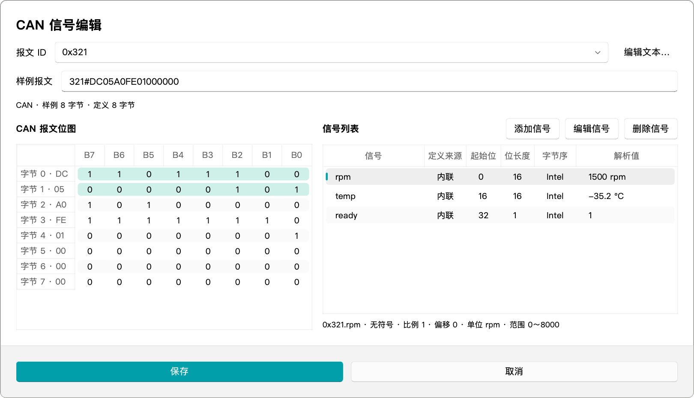
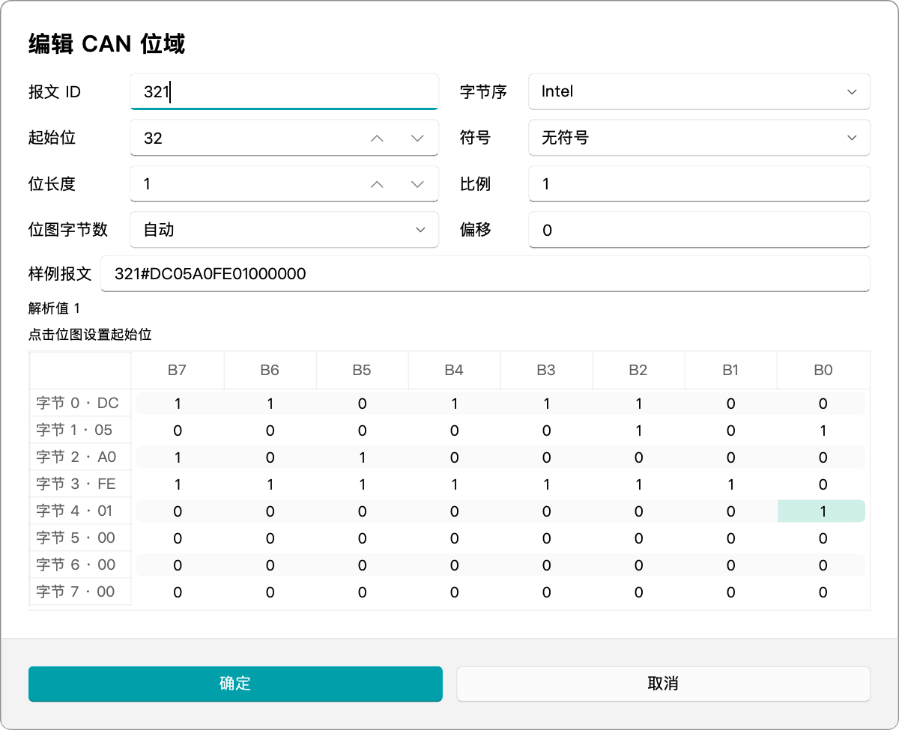
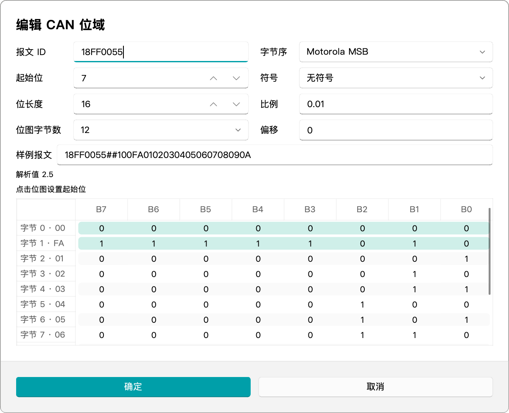

# View and bind CAN signals on the bit map

[简体中文](can-bit-map.zh.md) · [CAN project reference](../uidp/can.md)

Open [17.7 Classic CAN and CAN FD](../../examples/tutorials/17.7-CAN经典帧与FD信号.uidp). Paste samples in the designer, then use the built-in virtual CAN link to check the new point in Preview.

## Inspect the signal layout

1. Select the CAN channel card on the canvas. In the property panel, go to **CAN signals → Open visual editor…**.
2. Choose message ID `0x321` and select `rpm` in the signal list. Each row is one payload byte, with columns `B7` through `B0`. The highlighted cells cover bits `0–15`.
3. Paste `321#DC05A0FE01000000` in **Sample frame**. The decoded values update as you type. The cells show the sample's bits and each row shows its HEX byte.

| Signal | Bits | Sample bytes | Decoded value |
| --- | --- | --- | --- |
| `rpm` | 0–15 | `DC 05` | `1500 rpm` |
| `temp` | 16–31 | `A0 FE` | `-35.2 °C` |
| `ready` | 32 | `B0` of `01` | `1` |

Select an inline signal and click **Edit signal** to set its start bit on the grid. To inspect a DBC signal, open [12 CAN send and receive](../../examples/tutorials/12-CAN收发测试.uidp) with its [DBC file](../../examples/tutorials/12-CAN收发测试.dbc) in the same folder. Use the visual editor on **CAN 1**, select `0x100 · Command` and `Speed`, and paste `100#DC05050000000000` to see `1500 rpm`. DBC definitions are read-only in the editor.

## Bind a project point to one bit

Open **Data and alarms → Data points** to inspect the built-in loopback ready point, which reads `can → 0x321 → ready`. The following steps create a separate point manually in a project copy.

1. In **Data points**, add a point named `ReadyFeedback`. Select **Device data**, then click **Configure binding…**.
2. Select **CAN bit field** as the parser mode and `can` as the source. Open the visual editor. Set the message ID to `321`, the bit length to `1`, and the byte order to **Intel**. Use an unsigned value, scale `1`, and offset `0`.
3. Click **B0** in the **Byte 4** row. The start bit becomes `32`. Paste `321#DC05A0FE01000000`. The highlighted bit and the decoded value both read `1`.
4. Change the sample to `321#DC05A0FE00000000` and check the decoded value `0`. Changing the sample ID to `322` triggers a mismatch message. Sample text is used for preview. Confirm all three dialogs and save the project.
5. In **Preview → Run preview**, connect virtual CAN and send the `0x321` standard frame with the provided button. In **Project data monitor**, check that `ReadyFeedback` is `1` and its source is `can`.

Use **Create data point from CAN signal…** in the card's properties to start with an existing definition. For an existing point, choose **Named CAN signal → Browse signals visually…** and select `can → 0x321 → ready`. The binding summary shows `0x321.ready`. The same picker is available on each real-time curve and on each timing channel in **Per-channel binding** mode.

## Inspect a 12-byte CAN FD sample

1. In 17.7, open **Data and alarms → Data points**, configure the loopback pressure point, and open the visual editor. It uses ID `0x18FF0055`, **Motorola MSB**, start bit `7`, length `16`, and scale `0.01`. The pressure display reads this project point.
2. Set **Bit map size (bytes)** to `12` to reach bytes 8–11 before pasting a sample. When a DBC defines the message, the editor reads its byte count from the DBC.
3. Paste `18FF0055##100FA0102030405060708090A`. The grid highlights `00 FA` and shows `2.5`. The `##` marks an FD frame. The following `1` enables BRS. The payload starts at `00`. You can also paste a complete frame line from the log.

Intel starts at the signal's least significant bit. Motorola MSB uses the most significant bit as numbered by DBC. Choose Motorola LSB when the device specification gives the least significant bit of a Motorola signal. The grid highlights the bits used by the selected byte order.
