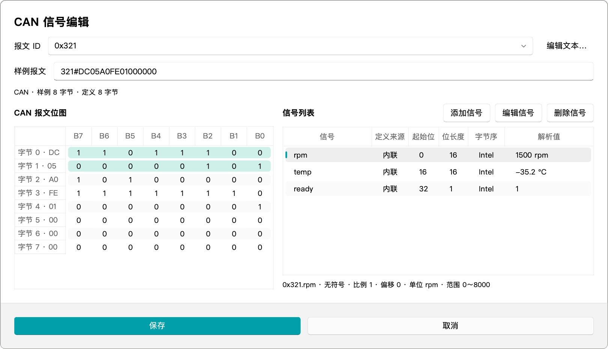
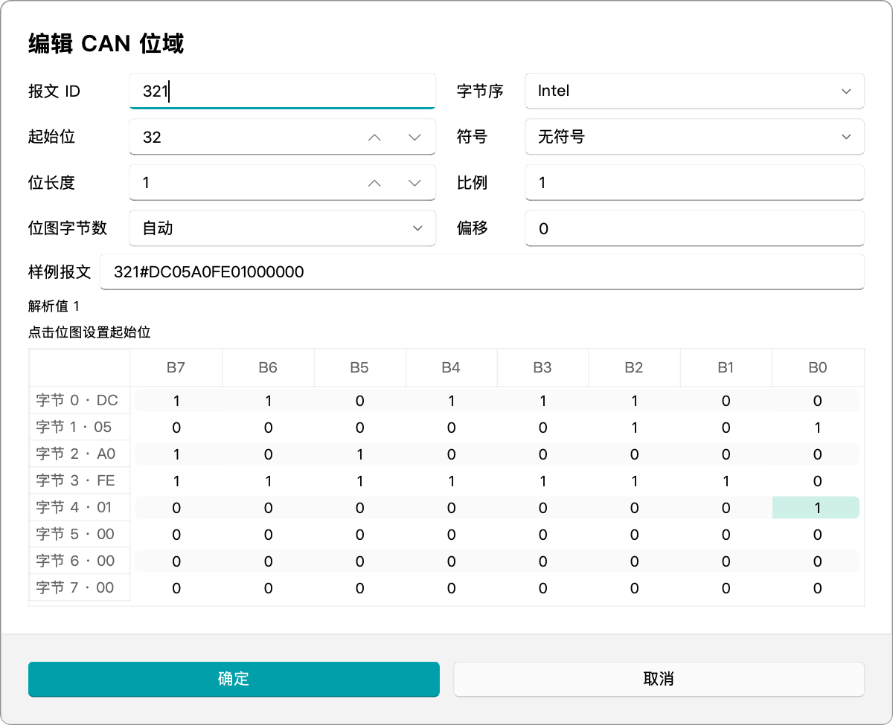
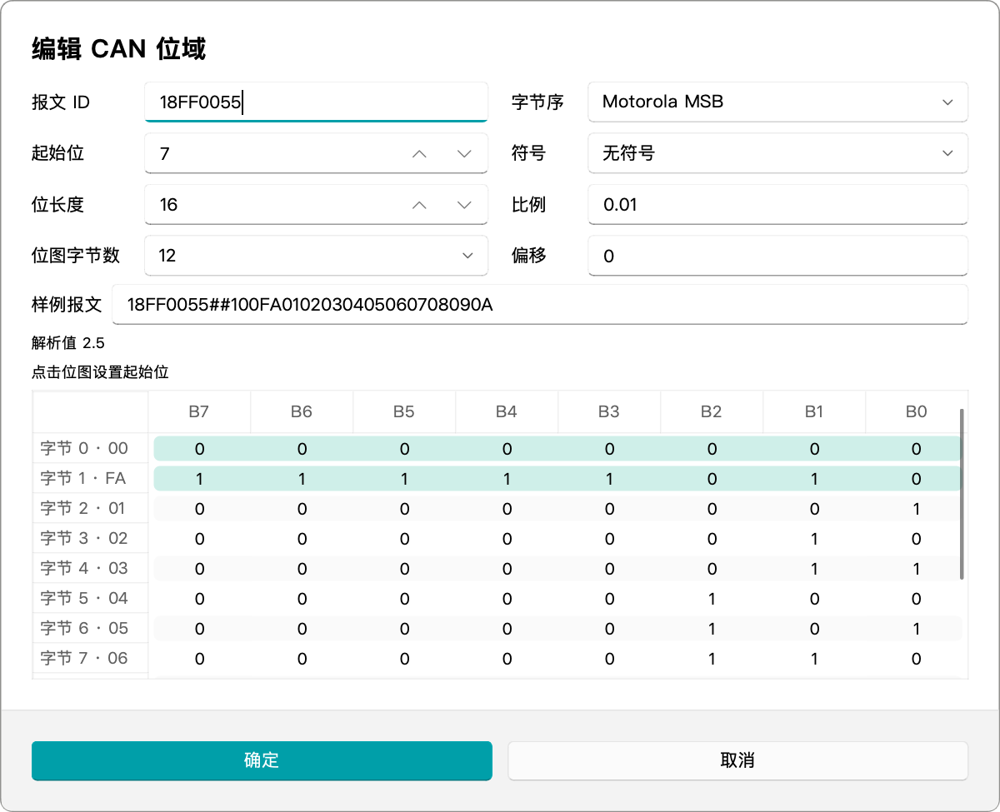

# 用位图查看和绑定 CAN 信号

[English](can-bit-map.en.md) · [CAN 工程参考](../uidp/can.md)

打开 [17.7 CAN 经典帧与 FD 信号](../../examples/tutorials/17.7-CAN经典帧与FD信号.uidp)。前几步在设计器里粘贴样例即可完成，最后用内置虚拟 CAN 核对工程数据点。

## 在 CAN 配置卡上查看信号

1. 在画布上选中「CAN 通道」，在右侧打开「常规 → CAN 信号 → 可视化编辑…」。
2. 报文 ID 选择 `0x321`，点击右侧的 `rpm`。位图每行是一个数据字节，列从 `B7` 到 `B0`。高亮应覆盖整整两个字节，即位 `0–15`。
3. 在「样例报文」粘贴 `321#DC05A0FE01000000`。解析会即时更新。各格显示样例中的位值，行首同时显示该字节的 HEX。

| 信号 | 位编号 | 样例字节 | 解析值 |
| --- | --- | --- | --- |
| `rpm` | 0–15 | `DC 05` | `1500 rpm` |
| `temp` | 16–31 | `A0 FE` | `-35.2 °C` |
| `ready` | 32 | `01` 的 `B0` | `1` |

这三条是内联信号，可在列表选中后点「编辑信号」，再点位图指定起始位。要看 DBC 信号，在同一目录备好 [12 CAN 收发测试](../../examples/tutorials/12-CAN收发测试.uidp) 和 [配套 DBC](../../examples/tutorials/12-CAN收发测试.dbc)。打开该工程，选中「CAN 1」，在位图中选择 `0x100 · Command` 和 `Speed`，粘贴 `100#DC05050000000000` 可看到 `1500 rpm`。DBC 定义在窗口中为只读。

## 在工程数据点上按位取值

打开「数据与报警 → 数据点」，可直接检查现成的「回环就绪」，它读取 `can → 0x321 → ready`。下面在工程副本上练习从位图手动定义另一个点。

1. 在「数据点」点「添加」，把新点命名为「就绪反馈」。取值方式选「设备数据」，再点「设置绑定…」。
2. 解析模式选「CAN 按位取值」，来源连接选 `can`，点「可视化编辑…」。报文 ID 填 `321`，位长度填 `1`，字节序选 `Intel`，使用无符号、比例 `1`、偏移 `0`。
3. 点位图「字节 4」这一行的 `B0`。起始位应变为 `32`。粘贴 `321#DC05A0FE01000000`，确认高亮位的值为 `1`，下方也显示「解析值 1」。
4. 将样例换成 `321#DC05A0FE00000000`，解析值应变为 `0`。若把样例的 ID 换成 `322`，窗口会提示 ID 不匹配。样例只用于预览。依次点三个窗口的「确定」应用绑定，再保存工程。
5. 进入「预览运行 → 运行预览」，连接虚拟 CAN。点「发 0x321 标准帧」并确认。打开「工程数据监视」，查看「就绪反馈」的值 `1` 和来源 `can`。

已有信号定义时，可在 CAN 卡的属性里点「从 CAN 信号创建数据点…」，由所选信号带入绑定。要改现有点，在「数据点来源」选「CAN 信号名称」，点击「可视化选信号…」，选择 `can → 0x321 → ready` 并点「选用信号」。绑定摘要会显示 `0x321.ready`。实时曲线的每条曲线和时序图「逐路绑定」的每一路都使用相同入口。

## 看 12 字节的 CAN FD 样例

1. 在 17.7 打开「数据与报警 → 数据点」，选择「回环压力」的「设置绑定…」，点「可视化编辑…」。该数据点读取报文 `0x18FF0055`，使用 `Motorola MSB`，起始位 `7`，长度 `16`，比例 `0.01`。「Motorola 大端压力」显示控件读取这个数据点。
2. 在「位图字节数」选择 `12`，可以先定位到字节 8–11。报文已有 DBC 定义时，窗口会从 DBC 读取字节数。
3. 粘贴 `18FF0055##100FA0102030405060708090A`。位图高亮前两个字节 `00 FA`，解析值为 `2.5`。样例中的 `##` 表示 FD，紧随其后的标志 `1` 表示启用 BRS，数据从 `00` 开始。也可以粘贴报文日志中的整行。

Intel 从信号的最低有效位编号。Motorola MSB 使用 DBC 的最高有效位编号。设备手册如果标的是 Motorola 最低有效位，请选 Motorola LSB。位图会按当前字节序高亮实际占用的位。
