# FluentHMI Studio v0.8 illustrated guide

[简体中文](v0.8-guide.zh.md) · [Release notes](../release-notes/v0.8.md#english)

Open the examples in Studio and run Preview. Exported apps use the same runtime interface. Select the circled information icon beside a field for instructions and copyable examples. The screenshots use sample frames and alarm events. Some example names and values are authored in Chinese.

## Route data and commands by connection

1. Add one connection card per link and give each a recognizable widget ID, such as `CAN_A` and `CAN_B`. On a dual-channel CAN adapter, configure the cards for CAN 0 and CAN 1.
2. Under **Data binding**, set **Source connection** for the display widget or each chart series. Under the sending widget's properties, set **Destination connection** separately. Matching CAN IDs or field names on two links are routed by the selected connections.
3. For a TCP server, UDP or MQTT, specify the client `IP:port`, peer `IP:port` or topic in the endpoint field. Switching cards clears the previous endpoint. For CAN and serial, select the connection card.

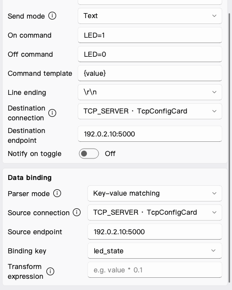

Serial, TCP, UDP and MQTT cards can inherit the project's parser. The property pane shows the effective parser. With Modbus, set each card's polling period and response timeout. [Routing and Modbus reference](../uidp/data.md#连接与子通道)

## CAN timing, individual outputs and recording

**Set bit timing.** With the card disconnected, select ZLG USBCAN-II. For a 500 kbit/s bus at 87.5%, select `500k` and `87.5%` and leave the custom field empty. To set a BTR explicitly, open **Calculate**, use 500k, 87.5% and SJW 1, select `00,1C`, and choose **Apply to card**. You can also type `00,1C` directly. Clear the custom field to return to the dropdown settings.

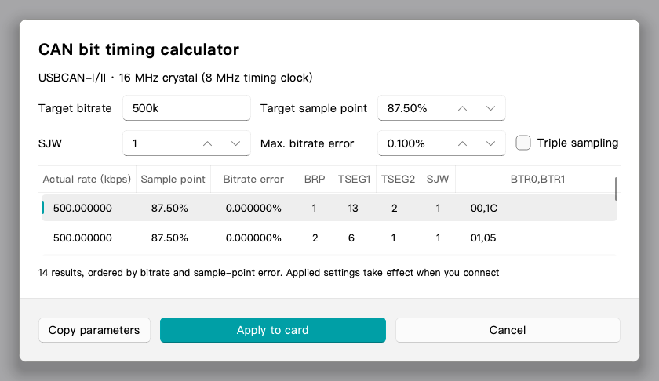

**Initialize an output frame from feedback.** If periodic status frame `IO` reports the output states and the matching signals in command frame `HMI` have the same names and encoding, enter `HMI=IO` under **Initial transmit state mapping** on the CAN card in the designer. For a red LED with the DBC signal `B4b4`, set the switch to send CAN frame `HMI` with template `B4b4={value}` and on/off values `1` and `0`. Use an explicit `TargetFrame.ControlSignal=StatusFrame.FeedbackSignal` mapping when names differ.

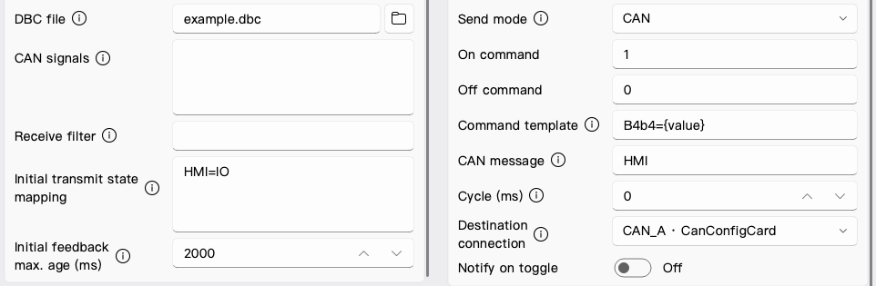

The first send after connecting requires recent valid feedback to initialize the mapped bits. Subsequent sends use the transmit cache for that connection. The device protocol and DBC determine which feedback signals represent the current output states. [Mapping requirements and field examples](../uidp/can.md#发送与监视)

**Record frames.** Open the CAN monitor's **Scrolling log** to inspect every frame by sequence number. Use the per-ID summary to see periods and counts. The save icon exports the currently filtered rows. The CSV's `time` column includes the date, milliseconds and time zone. For continuous capture, enable **Auto-save**, choose a folder, and set **Rows per file**. **Display rows** controls the table retention. Continuous capture records all transmit and receive frames on the selected connections. Open or change the destination from the folder button.

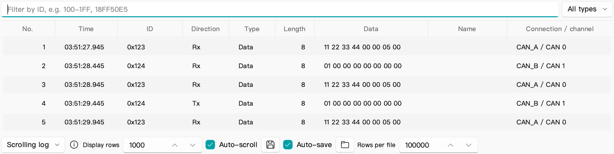

[CAN configuration and recorder reference](../uidp/can.md) · [CAN transmit and receive example](../../examples/tutorials/12-CAN收发测试.uidp)

## Project data and alarms

1. Open [14 · Project data and alarms](../../examples/tutorials/14-工程数据与报警.uidp). Select **Data and alarms** in the designer toolbar. You can also click empty canvas space and open **Project data and alarms** from the project properties.
2. On **Data points**, `L1` and `L2` receive the `fault` field from `PLC_A` and `PLC_B`. The combined point uses `T["L1"] or T["L2"]`. Choose **Project data point** as the widget's parsing mode to bind to a named point.
3. On **Alarms**, set the trigger condition, level, acknowledgement requirement and message. The example raises a level 3 alarm for a combined fault and a level 2 alarm at or below 20% battery charge.

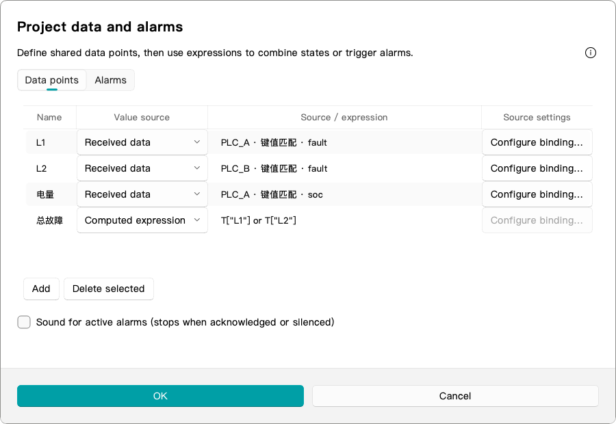

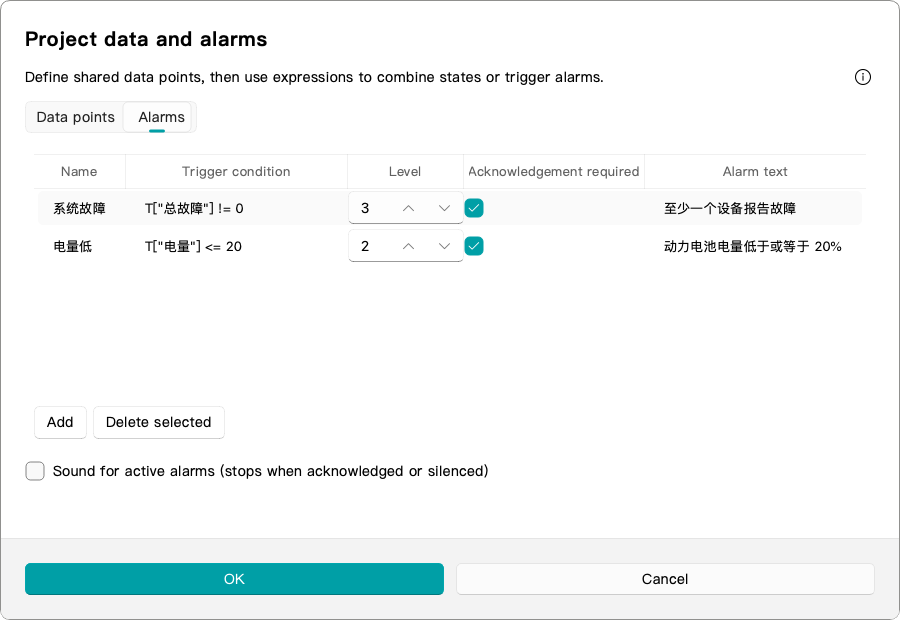

In Preview, start the two TCP servers. Connect local TCP clients to ports 9201 and 9202. Send `fault=0,soc=65` and `fault=0`, respectively, as newline-terminated messages. Set either `fault` to `1` or the charge `soc` to `20` to raise the matching alarm. [16 · Inputs and status filters](../../examples/tutorials/16-输入与状态筛选.uidp) also provides an alarm that triggers without a device.

**Filter history.** Switch the alarm list to **History**, open **Filter** and select **Custom time range**. Set the start and end dates and times with the Fluent calendar, the time picker or the keyboard. The range uses local time and includes both endpoint seconds. Filters remain active when collapsed. **Export filtered results** saves matching events. **Export all history** saves all recorded events.

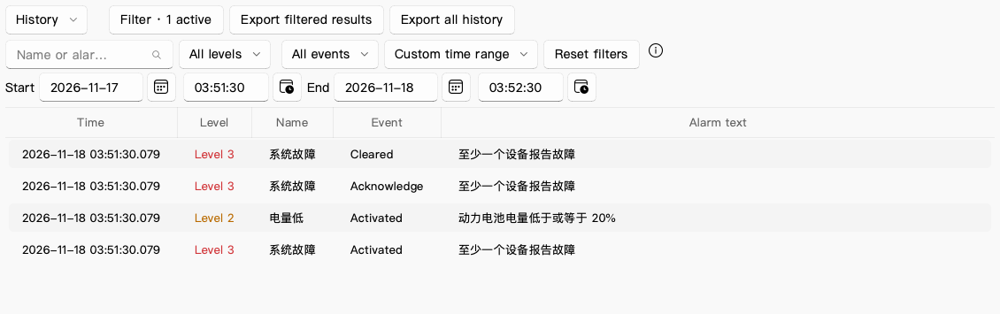

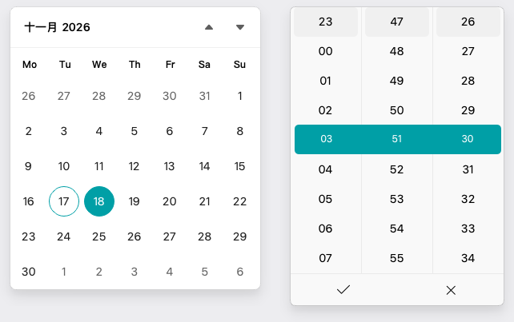

[Project points, alarm state and history reference](../uidp/alarms.md)

## Enum values, battery colors and input styles

Select a **Numeric display**, choose **Enum** under **Display format**, and enter one `value=text|color` mapping per line, such as `1=Running|#107c10`. Set **Display style** to **Status badge** for a compact status display.

On a traction battery widget, enable **Charge level colors**. The default limits are 20% and 40%. They divide the colors into up to 20%, over 20% through 40%, and over 40%. Bind the battery to a value from 0 to 100.

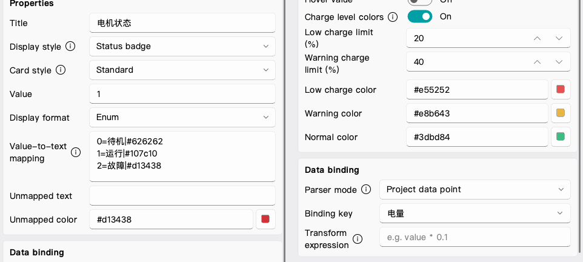

[16 · Inputs and status filters](../../examples/tutorials/16-输入与状态筛选.uidp) demonstrates decimal spin boxes, dropdowns, segmented and radio groups, switch and checkbox styles, and status badges. Select the widget in the designer to adjust its style and compare it in Preview. [Enum reference](../uidp/alarms.md#枚举显示) · [Traction battery properties](../uidp/industrial.md#文字锁定与电池颜色)

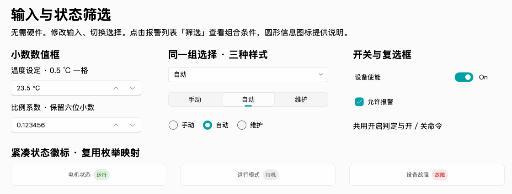

## Page navigation

Open [15 · Page navigation and widget styles](../../examples/tutorials/15-分页与控件风格.uidp) and run Preview to compare classic tabs, underline navigation, segmented navigation and document tabs. Buttons and cards also have their own style properties.

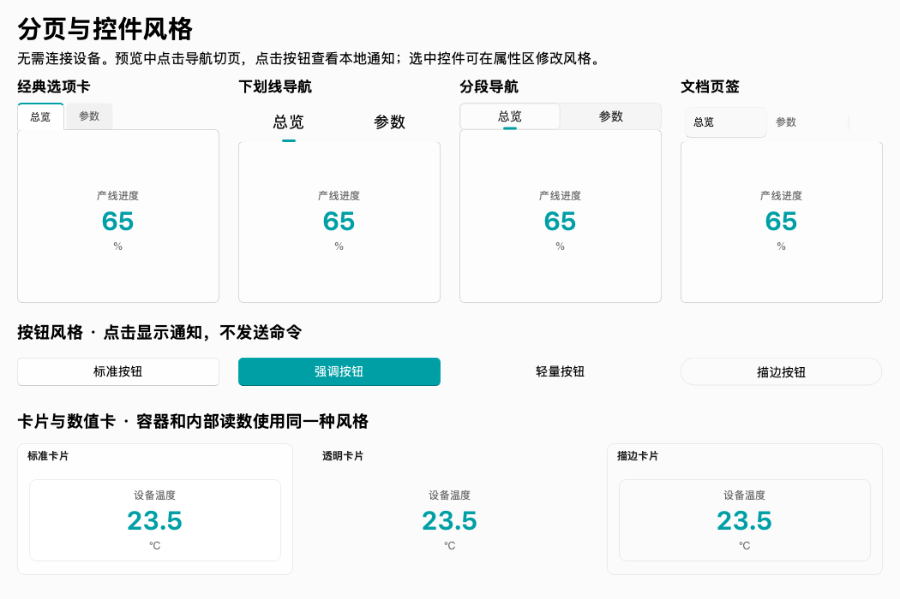

Select a page container in the designer and change **Navigation style**. **Page being edited** chooses the page on the design canvas. **Runtime start page** chooses the page opened by Preview and exported apps. Use the page management buttons to add, delete or reorder pages, and the page name field to rename the page being edited.

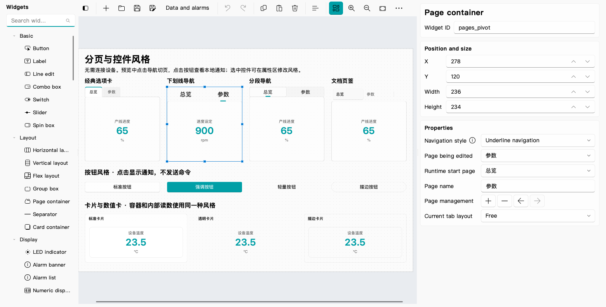

[Page properties, project compatibility and UIDP format](../uidp-format.md#分页与控件风格)
