# FluentHMI Studio v0.8 操作图解

[English](v0.8-guide.en.md) · [更新说明](../release-notes/v0.8.md)

以下示例可在设计器打开并预览，导出的独立应用使用相同的运行界面。点击字段旁的圆形信息图标可查看说明和可复制的示例。收发和报警截图使用示例数据。

## 多通道收发

1. 每一路连接放置一张连接卡片，并设置好辨认的控件 ID，例如 `CAN_A`、`CAN_B`。双通道 CAN 卡可分别选 CAN 0 和 CAN 1。
2. 选中显示控件，在「数据绑定 → 来源连接」指定从哪张卡接收。曲线可为每条曲线分别选来源。发送控件在「属性 → 发送连接」选择目标卡片。两路收到相同 CAN ID 或同名字段时，按所选连接分别更新。
3. TCP 服务端、UDP 和 MQTT 还可指定子通道，分别填写客户端 `IP:端口`、对端 `IP:端口` 或 Topic。切换连接时会清除原连接的子通道配置。CAN、串口等没有独立子通道选项的连接只需选卡片。

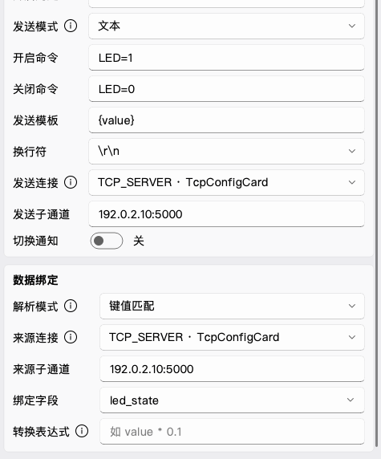

串口、TCP、UDP 和 MQTT 卡片的「默认解析模式」可跟随工程。属性区会显示实际采用的模式；使用 Modbus 时，轮询周期和响应超时按各卡片配置。[连接、对端与 Modbus 轮询参考](../uidp/data.md#连接与子通道)

## CAN 位时序、单点控制与记录

**位时序。** 预览或运行时，在断开状态选 ZLG USBCAN-II。总线要求 500 kbit/s、87.5% 时，可在卡片选择 `500k` 和 `87.5%`，自定义留空。需要显式设置 BTR 时，点击「计算」，用 500k、87.5%、SJW 1 计算，选中 `00,1C` 后点「应用到卡片」。也可直接输入 `00,1C`。自定义有内容时使用该值，清空即可恢复下拉选项。

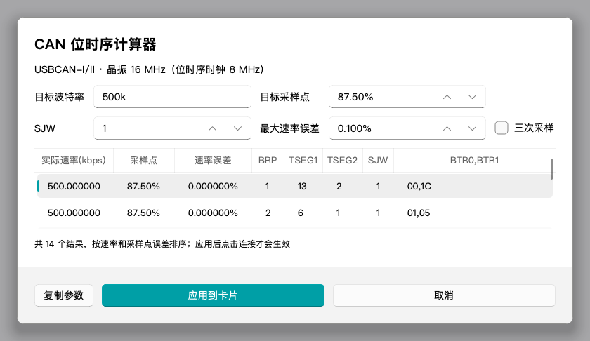

**从反馈初始化控制。** 如果设备周期广播包含各输出状态的 `IO`，且控制报文 `HMI` 与它的输出信号同名、编码一致，可在设计器选中 CAN 连接卡片，在「属性 → 发送初值映射」填 `HMI=IO`。若 LED_RED 在 DBC 中的控制信号叫 `B4b4`，则在开关属性中将「发送模式」设为 CAN、「CAN 报文」填 `HMI`、「发送模板」填 `B4b4={value}`，开启／关闭命令分别填 `1`／`0`。信号名称不同时可用 `目标报文.控制信号=反馈报文.状态信号` 明确对应关系。

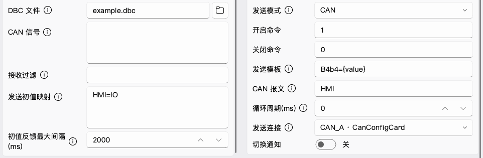

每次建立连接后的首次发送使用有效期内的反馈初始化映射位，随后沿用该连接的发送缓存。未收到有效反馈时阻止首次发送。设备广播状态即可用于初始化；设备的报文是否能表示输出状态由其协议和 DBC 决定。[映射要求和字段示例](../uidp/can.md#发送与监视)

**记录报文。** 在「报文监视」选择「滚动日志」可按序号逐帧查看，切到「按 ID 汇总」可查看周期和次数。点保存图标导出当前筛选结果，CSV 的 `time` 列带日期、毫秒和时区。需要连续留档时，勾选「自动保存」，选目录并设定「每文件行数」。表格的「显示行数」只控制屏幕保留的行，自动保存会记录所选连接的全部收发帧。运行中可用文件夹按钮打开或更换目录。

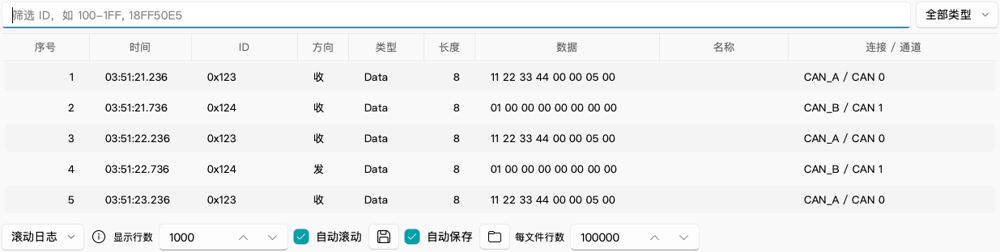

[CAN 卡片、位时序、记录和配套工程](../uidp/can.md) · [CAN 收发测试工程](../../examples/tutorials/12-CAN收发测试.uidp)

## 工程数据与报警

1. 打开 [14 · 工程数据与报警](../../examples/tutorials/14-工程数据与报警.uidp)，点击设计器顶部的「数据与报警」。也可以选中画布空白处，在工程属性点击「工程数据与报警…」。
2. 在「数据点」中，`L1`、`L2` 分别从 `PLC_A` 和 `PLC_B` 读取 `fault`，计算点「总故障」使用 `T["L1"] or T["L2"]`。控件的「数据绑定 → 解析模式」选「工程数据点」后即可引用这些名称。
3. 切到「报警」设置触发条件、级别、确认要求和文字。示例中总故障非零触发三级报警，电量降到 20% 或以下触发二级报警。

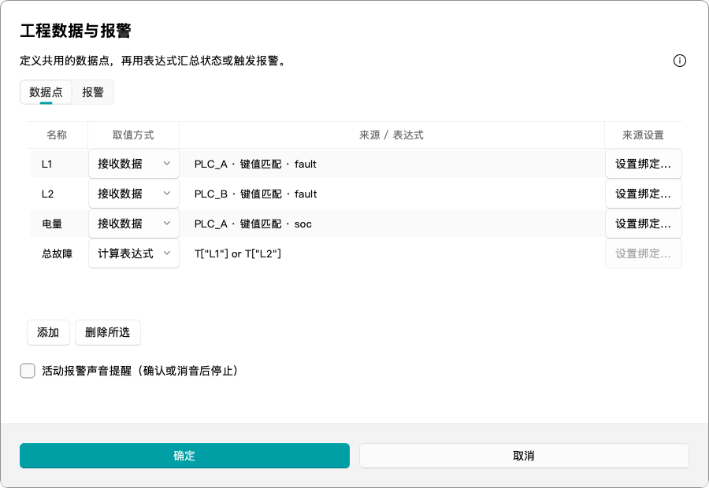

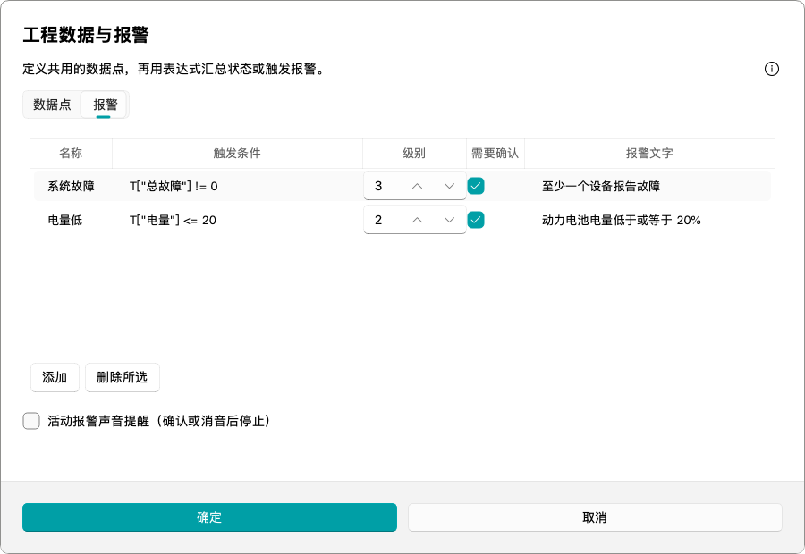

预览后启动两路 TCP 服务端，用本机 TCP 客户端分别接入 9201 和 9202。初始每行分别发送 `fault=0,soc=65` 和 `fault=0`。把任一路 `fault` 改为 `1` 或把 `soc` 改为 `20` 即可触发对应报警。也可打开 [16 · 输入与状态筛选](../../examples/tutorials/16-输入与状态筛选.uidp)，直接用预置的温度报警试筛选。

**查历史。** 在报警列表切到「历史记录」，点「筛选」，选「自定义时间」。分别设置起止日期和时分秒，可用 Fluent 日历、时间选择器或键盘输入。日期时间按本地时间比较，包含起止秒。条件收起后继续生效。「导出筛选结果」导出当前匹配事件，「导出全部历史」导出全量事件。

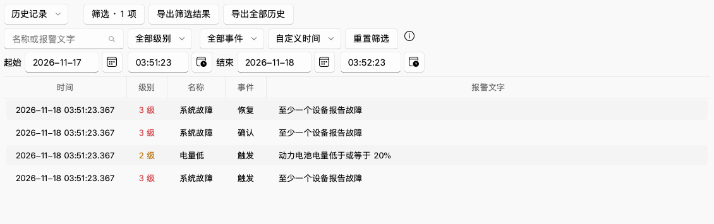

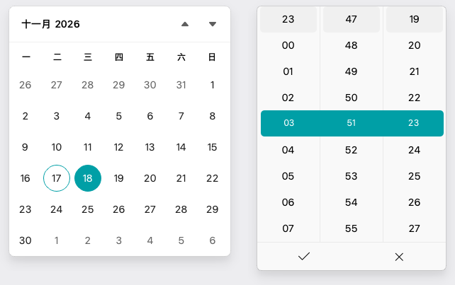

[工程数据点、报警状态和历史参考](../uidp/alarms.md)

## 枚举、电池变色与输入风格

选中「数值显示」，将「显示格式」设为「枚举」，在「枚举映射」逐行填写 `值=文字|颜色`，例如 `1=运行|#107c10`。将「显示样式」设为「状态徽标」可在紧凑布局中显示状态。

选中「动力电池」，在属性区开启「电量分段变色」。默认低电量上限为 20%、预警电量上限为 40%。把读值绑定到 0～100 的百分数，20% 及以下使用低电量色，超过 20% 至 40% 使用预警色，超过 40% 使用正常色。

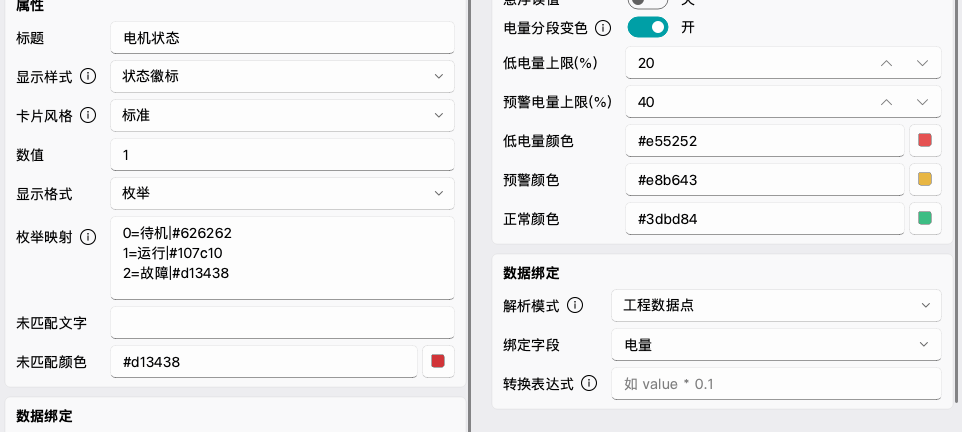

[16 · 输入与状态筛选](../../examples/tutorials/16-输入与状态筛选.uidp) 包含小数数值框、下拉框／分段／单选组、开关／复选框和状态徽标。选中相应控件即可在属性区修改样式，用预览比较外观。[枚举参考](../uidp/alarms.md#枚举显示) · [动力电池属性](../uidp/industrial.md#文字锁定与电池颜色)

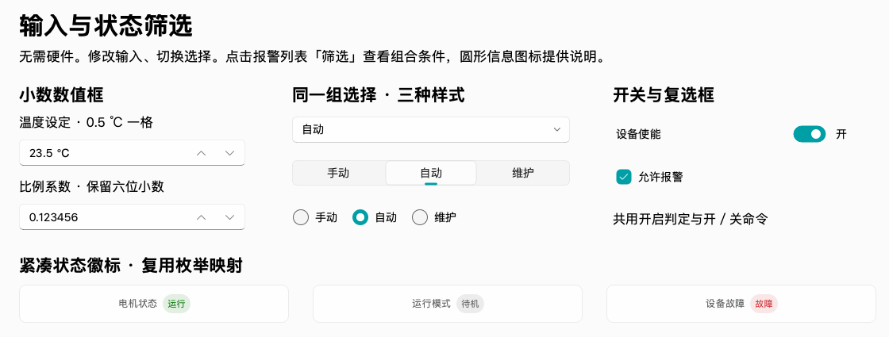

## 分页导航

打开 [15 · 分页与控件风格](../../examples/tutorials/15-分页与控件风格.uidp)，预览可比较经典选项卡、下划线导航、分段导航和文档页签。按钮和卡片的风格也可在各自的属性区修改。

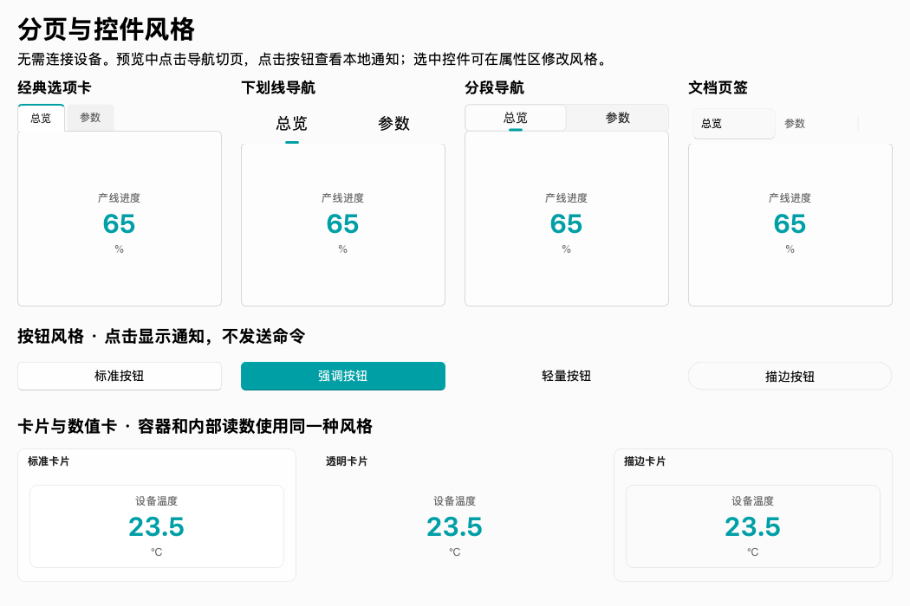

在设计器选中分页容器，通过「导航风格」切换样式。「当前编辑页」决定画布上编辑哪页；「运行时启动页」决定预览和导出应用打开时显示哪页。「页面管理」用加号、减号和箭头调整页数与顺序，在「页面名称」修改当前编辑页的名称。

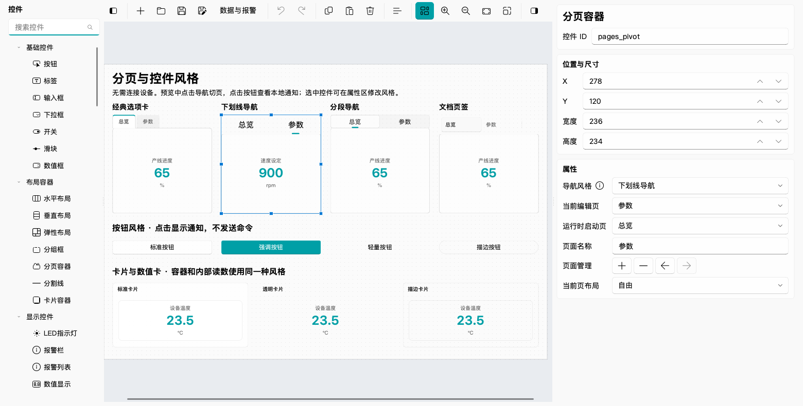

[分页属性、旧工程行为与 UIDP 格式](../uidp-format.md#分页与控件风格)
